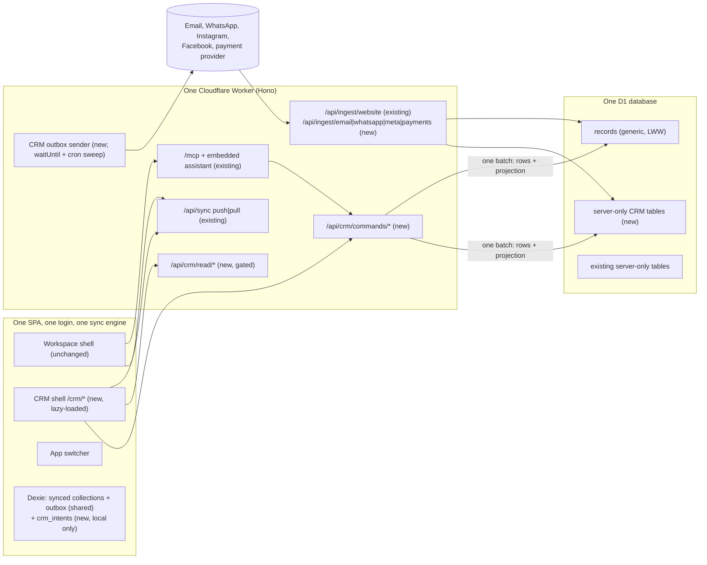

# Architecture decisions

Each ADR is **Proposed** until you approve it. "Rejected" alternatives were considered on their merits, not as straw men.

## Overview

## ADR-01. One codebase, one Worker, one database (modular monolith)

**Decision (proposed).** Build the CRM inside `YHWH3/tcg-workspace`: client code under `src/apps/crm/`, shared pure logic under `shared/crm/`, server code under `worker/crm/`, migrations continuing from `0045`. Same build, same Worker, same D1.

| Alternative | Why not |
|---|---|
| CRM as more modules in the Workspace shell | Violates A-13 (distinct design) and would crowd the Workspace sidebar with 10+ CRM entries |
| Separate SPA, same Worker | Two builds, two service workers, two caches for one login; offline and account-switch logic would need duplicating |
| Separate Worker and repo sharing the D1 binding | Duplicates auth, read gate, sync, MCP and changesets; two deployments to keep in step; shared-DB writes from two codebases break the "one write path" invariant |
| Adopt an open-source CRM and sync it with Workspace | Two identity stores and two permission models for one small team; AI governance would have to be rebuilt around it; contradicts A-04 |
| Fork Workspace into a CRM | Two copies of the same platform to maintain; regresses A-03 and A-04 |

**Consequences.** CRM code must respect every existing invariant (`AGENTS.md`): writes via `mutate()`/`applyChanges()`, server-only tables never in `COLLECTIONS`, the read gate on every user-visible read, the 45-call D1 budget, no module-level mutable state in the Worker.

## ADR-02. Distinct CRM shell under `/crm`, shared session

**Decision (proposed).**

- Add a **separate top-level route object** `{ path: 'crm/*', element: <RequireAuth><CrmShell/></RequireAuth> }` in `src/App.tsx`, beside (not inside) the pathless route whose element is `<RequireAuth><Shell/></RequireAuth>` (`src/App.tsx:53-70`). It cannot be a child of that route, because `Shell` renders the Workspace chrome. React Router ranks `crm/*` above that route's catch-all `*` (`:68`), so `/crm` never redirects to `/`. `RequireAuth` (`:30-35`) gives the CRM the same login screen and `AccessBarrier`. `AccountSwitchGate` and `LegacyRecoveryGate` are rendered outside the router (`:90-91`) and the sync engine starts once in `App()` (`:73-85`), not per shell, so both apps share them without further change. The Worker already serves `/crm/*` as the SPA (`wrangler.jsonc:11`, `not_found_handling: single-page-application`) and the service worker's navigation fallback covers it (`src/sw.ts:90`).
- `CrmShell` is a lazy-loaded chunk with its own layout, navigation and styles scoped under `[data-app="crm"]`. Workspace CSS and components are untouched.
- An **app switcher** (Workspace | CRM) appears in both shells' top-left. The only Workspace UI change is this control, shown only when the Worker variable `CRM_ENABLED` is on and the account holds `crm.access` (P-24); otherwise `/crm` shows the access-denied state and Workspace renders exactly as before.
- Deep links: every CRM record has a stable URL `/crm/<area>/<entity>/<id>`; Workspace record URLs keep working; a CRM record panel can "Open in Workspace" and vice versa.
- Remember the last app per device (local preference only).

**Rejected.** Subdomain per app (two origins break the shared service worker and storage); iframe embedding (accessibility and focus problems).

## ADR-03. Two data tiers, split by consequence

| Tier | Holds | Storage | Write path | Offline |
|---|---|---|---|---|
| **Relationship tier** | People, Organisations, Affiliations, Programmes, Editions (descriptive fields), Places, Applications, Opportunities, Activities and follow-ups, notes | Existing `records` (generic databases from the TCG pack, upgraded additively) | `mutate()` / `applyChanges()`; per-field LWW; history; undo | Full |
| **Operational tier** | Contact endpoints, consent, aliases and merges, channel accounts, conversations, messages, outbox, inbound events, templates, edition capacity and allocations, bookings, participants, screening, payment requests, ledger entries, receipts, memberships, capability grants, operational facts, command journal | New server-only D1 tables (never in `COLLECTIONS`) | Server commands only | Read cached projections; actions queue as pending intents |

**Rule of thumb.** If getting it wrong would message a person, take or return money, promise or deny a seat, or expose restricted information, it is operational tier.

**Rejected.** Everything generic (cannot enforce capacity or money integrity under LWW); everything purpose-built (throws away the configurable database platform, views, MCP and AI governance that already work).

## ADR-04. Projections and server-owned fields

Operational results that people need to see in grids (seats confirmed, balance due, membership valid-until, last inbound message time) are written by the command handler onto the related record as **projection fields** with a reserved prefix `_crm_`, inside the same D1 batch as the operational rows.

- **Corrected fact.** `authorizeMutations` rejects fields starting with `_` (`worker/mutationAccess.ts:66-67`), but `applyChanges` calls it only when `access_state.enabled = 1` or the request comes from a connector (`worker/sync.ts:352-355`). With permissions off, which is how the pilot runs (A-19), a client push could write `_crm_` fields today. The earlier version of this ADR relied on that rule and was wrong for the pilot.
- **Revised design.** (1) An **unconditional, item-wise pre-check** in `applyChanges`, before the permission branch: any change whose patch has a `_crm_` key not covered by `opts.projection` is rejected with `protected_field` in both permission modes (the "policy refusal is item-wise" invariant). (2) `authorizeMutations` gains an optional projection grant so that, when permissions are on, the listed `_crm_` keys of a registered command are not caught by the general `_` rule; the space edit checks still apply. (3) `opts.projection = { command, keys }` is set only by `worker/crm/commands.ts` from a static per-command key list; the sync router, MCP generic tools, automations, history restore and undo never set it. Exact code shape: `S0-PLAN.md` section 6.3.
- Only the `_crm_` prefix gets the unconditional rule; other `_` keys keep today's behaviour, so no existing Workspace write path changes.
- Template instantiation copies only `p_` keys and named built-ins (`shared/templates.ts:300-315`), so templates never carry `_crm_` keys.
- Projections are display data. Decisions (can this seat be confirmed? is this paid?) always read the operational tables, never the projection.
- If a projection write fails, the command fails as a whole (one batch).

## ADR-05. Canonical identity, endpoints, merge

- **Canonical person ID = the existing People record ID.** Website-created IDs (`person_<sha>`, `worker/websiteIngest.ts:445-446`) stay valid forever.
- `crm_endpoints` stores every way to reach a person: email, phone (E.164), WhatsApp ID, Instagram-scoped ID, Facebook page-scoped ID, with normalised value, source, verification and state. A unique index on `(kind, normalized)` for active rows means one endpoint belongs to one person.
- The People "Email" field remains as the primary email for compatibility with website matching. The command that changes a primary endpoint updates both.
- Matching for new inbound identities: exact endpoint match links; anything else (same name, similar email) creates a **duplicate review** item with reasons. No fuzzy auto-merge.
- **Merge** is a command: survivor chosen by a person; all relation links, conversations, bookings, memberships and ledger references move to the survivor; the merged record is archived with `_crm_merged_into`; `crm_person_aliases` maps the old ID; a merge journal allows admin unmerge (restores links that were moved, not edits made after the merge).
- Ingest paths resolve aliases before matching, so a website submission for a merged email lands on the survivor.

**Rejected.** A separate CRM contacts table (duplicate People); storing endpoints as generic fields (no uniqueness guarantee under LWW).

## ADR-06. Applications reference immutable submissions

The Website inbox record remains the immutable source submission (its body is the sender's words, its status is triage status). A CRM **Application** is a separate record in an Applications database, linked to the submission and the person, carrying the programme-specific stage, reviewer, decision and conversion. Programme settings decide whether Applications are created automatically from a form family or by a triage action.

**Why.** Programme lifecycles differ; overloading the website inbox's four statuses would either flatten them or force 20 forms into one stage list. Keeping the submission untouched preserves the integration contract and its AI source-dependency checks.

## ADR-07. Programmes as configuration over six engines

- The pack **Programs** database becomes the programme registry (14 records). Each has a **programme profile** (stored as a validated JSON field and edited through a settings screen): area, lead, engines enabled, application database and stage set, booking settings, membership scheme, form families and IDs mapped to it, default views, templates, response target, restricted fields.
- Engines are code: Relationships, Conversations, Applications, Bookings, Money, Membership. The existing Opportunities database provides pipelines.
- Nothing in engine code names a TCG programme. That is what keeps "reusable later" cheap (A-02) without building tenancy now.

## ADR-08. Bookings: server-authoritative capacity on D1

- `crm_editions` holds capacity and booking policy for each bookable Event record.
- Seat changes are rows in `crm_allocations` (hold, confirmed, released). Confirmation is one conditional `INSERT ... SELECT ... WHERE (current confirmed + held, excluding expired) + requested <= capacity` inside a single `db.batch` with the booking row and projection. D1 executes a batch as one transaction and serialises writes for a database, so two concurrent confirmations cannot both succeed. (The repository already depends on batch atomicity: every fence statement that raises inside a batch rolls the whole batch back, for example `accountBatch` in `worker/admin.ts:106`. The concurrency property itself is still to be proven by the S6 property test, not assumed.) The command checks the inserted row count and returns `capacity_exceeded` when it is zero.
- Holds expire by time. Expiry is evaluated in the same predicate (expired holds do not count) and a cron sweep marks them released for display and notifications.

**Rejected.** A Durable Object per edition (strict, but adds a new stateful component, migration and failure mode for a load D1 handles); optimistic counting on records (cannot be made safe under LWW).

## ADR-09. Money: integer minor units, append-only ledger

- `crm_ledger_entries`: amount as signed integer minor units, ISO 4217 currency, kind (receipt, refund, adjustment, fee, payout), related object, evidence (provider event ID, or uploaded proof file ID plus recorder), idempotency key, `reverses_entry_id`. SQL triggers block UPDATE and DELETE.
- Balances are computed per object and currency; mixed-currency totals are refused, as `shared/finance.ts` already does for summaries.
- Payment requests are separate from receipts; partial payments and over-payments are visible states, not errors.
- The Patron flow stays in the relay; the CRM only displays it.
- Formal accounting remains external; the CRM exports.

## ADR-10. Authorization: capabilities on top of roles

- Keep workspace roles and space roles exactly as they are (`shared/access.ts:3-4`).
- Add `crm_capability_grants (user_id, capability, scope)` where scope is a programme ID or `'*'`. Capabilities: `crm.access`, `crm.configure`, `crm.send:<channel>`, `crm.restricted.read`, `crm.finance.read`, `crm.finance.record`, `crm.refund.approve`, `crm.merge`, `crm.channels.manage`, `crm.capabilities.manage` (`07` section 3).
- **Owner holds all, implicitly (A-21).** Computed from the current `users.workspace_role = 'owner'` at check time; no rows, nothing to revoke. New accounts hold none. No other role implies anything; `crm.capabilities.manage` is grantable only by the owner and only effective while the holder's current role is `admin`.
- **Grant and revoke are audited server commands** with an append-only `crm_capability_audit` table. A separate CRM table, not the Workspace `access_audit` table (`migrations/0012_phase5_access_foundation.sql:63-76`), so CRM rows never mix with the Phase 5 access generation semantics that table records; the Settings History tab reads only the CRM table.
- Every command and restricted read checks the capability on the server against current state (never a cached session hint), in the same batch that writes, as `websiteGrantFence` does for ingest (`worker/websiteAuthority.ts:19`) and `adminSessionFence` does for account changes (`worker/admin.ts:19-24`). **This check never depends on `access_state.enabled`.**
- Relationship-tier records still follow space permissions. While `access_state.enabled=0`, every account can read them; the owner accepted this for the pilot (A-19).
- MCP connector authority intersects with these capabilities; AI never holds a capability of its own; grant and revoke are never MCP tools.
- Naming: the repository already uses "capability" for space capability levels (`worker/capability.ts`) and for the AI tool registry (`shared/aiCapabilities.ts`). CRM code uses `CrmCapability` types and lives in `shared/crm/capabilities.ts` and `worker/crm/grants.ts` to avoid confusion.

## ADR-11. Channels: adapters, signed inbound routes, one outbox

- One adapter interface per provider (`send`, `parseInbound`, `verifySignature`, `mapStatus`, `windowState`, `listTemplates`), off by default, with a simulated adapter used only under `WORKSPACE_ENV=local-test`.
- Inbound: one signed route per provider (`/api/ingest/<provider>`), following the website ingest pattern: verify signature, store the raw event with a unique provider event ID (dedupe), acknowledge fast, then process.
- Inbound for pull providers: Zoho Mail (A-22) is polled from the cron with a stored cursor and the same `crm_inbound_events` dedupe (`09` section 1.7); push is used only where verified.
- Outbound: `crm_outbox` with leases, exponential backoff, a retry cap, provider idempotency keys where supported, receipts, and a final Failed state for review. The send runs immediately via `waitUntil`; the existing 15-minute cron (`wrangler.jsonc:49`) sweeps retries and stuck leases.
- Media goes through the existing file storage pipeline. The 20 MB limit is per file in both storage modes (`worker/fileStore.ts:26`), not a D1-only limit. Private R2 is implemented (`worker/fileStore.ts`) but not enabled at the pinned config (`wrangler.jsonc:22-24`: `r2_buckets` commented out, `FILE_STORAGE` `d1`, 450 MB quota); enabling it is an owner step and should precede channel media at any volume.
- Email provider: Zoho Mail (A-22). WhatsApp number strategy remains open (O-04).

## ADR-12. AI and MCP on the existing governance

- CRM tools register in `shared/aiCapabilities.ts` like every other tool; the drift test keeps the registry honest.
- Read tools are embedded-allowed. Relationship-tier writes use the existing preview and approval path. Operational side effects (send, confirm booking, record payment, refund, merge) are **human-only** (`H`) or **proposal-only** (`P`): the assistant can prepare them; a person executes them from the CRM UI with the required capability.
- Full detail in `10`.

## ADR-13. Offline behaviour

- Relationship-tier edits work offline as today.
- Operational actions taken offline become **intents** in a new local-only Dexie table `crm_intents` (never a synced collection), each with a client idempotency key. They are sent to the command API when online; the UI labels them "Request, not confirmed" until the server replies.
- Projections arrive by normal pull and are read-only.
- On access change or account switch, `crm_intents` for that account are quarantined with the same rules as the outbox.
- Adding `crm_intents` is a Dexie schema bump (the current schema is version 9, `src/core/db.ts:129`) and must join the existing account-local quarantine and rollback handling; it lands with S6, not S0. Capability changes are never queued offline.

## ADR-14. Preserve Workspace; stay portable

- No Workspace route, module, collection or style changes except the switcher and the additive pack upgrade.
- CRM engines contain no TCG names; TCG specifics live in the pack and programme profiles. A future second organisation would be a second pack, not a code fork. No tenancy work now.
- The existing test suite and Studio demo are part of every CRM release gate (`11`).

## Service boundaries (server)

| Module | Owns | Talks to |
|---|---|---|
| `worker/crm/commands.ts` | Command registry (built per request by a function; no module-level mutable state), idempotency, journal, both commit modes, D1 budget wrapper | All engines |
| `worker/crm/grants.ts` | Capability evaluation and fences, grant/revoke handlers, audit reads | `users`, `sessions`, `crm_capability_grants`, `crm_capability_audit` |
| `worker/crm/identity.ts` | Endpoints, matching, duplicates, merge, aliases, consent | records (People), conversations |
| `worker/crm/conversations.ts` | Channel accounts, conversations, messages, templates, assignment | adapters, outbox, identity |
| `worker/crm/outbox.ts` | Sending, retries, receipts | adapters |
| `worker/crm/adapters/*` | Provider specifics | providers |
| `worker/crm/bookings.ts` | Editions, allocations, bookings, participants, screening, attendance | money, records (Events) |
| `worker/crm/money.ts` | Payment requests, ledger, receipts, reconciliation | bookings, membership |
| `worker/crm/membership.ts` | Schemes and memberships | money, records (People) |
| `worker/crm/read.ts` | Gated timeline and queue reads | all, via read gate |
| `worker/crm/mcp.ts` | CRM MCP tools | commands, read |
