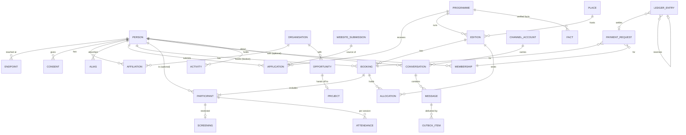

# Data model

Column lists below are design-level. Final DDL, indexes and migration numbering are a backend engineering task bounded by these rules.

## 1. Entity relationship diagram

Relationship-tier entities (generic records): PERSON, ORGANISATION, AFFILIATION, PROGRAMME, PLACE, EDITION (descriptive part, the pack Events record), APPLICATION, ACTIVITY, OPPORTUNITY, PROJECT, WEBSITE_SUBMISSION. Everything else is operational tier (server-only).

## 2. Relationship tier: databases and fields

Changes arrive as an additive pack upgrade (version 12 proposed). Existing fields keep their IDs.

### People (pack `people`)

| Field | Type | Required | Notes |
|---|---|---|---|
| Name (title) | built-in | yes | |
| Email | text (existing) | no | Primary email. Name must stay "Email" for website matching (`worker/websiteIngest.ts:427-428`). Written by the endpoint command. |
| Phone | text (existing) | no | Primary phone display; authoritative copy in endpoints |
| Preferred name | text | no | New |
| Location | text | no | New; free text (city, region, country) |
| Languages | multi-select | no | New |
| Disciplines and skills | multi-select (existing Skills) | no | Reuse |
| Interests | multi-select | no | New |
| Source | select | no | New: Website form, WhatsApp, Instagram, Facebook, Email, Referral, Event, Import, Manual |
| Relationship owner | person (existing) | no | Workspace account |
| Next conversation | date (existing) | no | Kept; follow-ups are Activities |
| Programmes | relation to Programs | no | New; reverse on Programs |
| Notes | text (existing) | no | Non-sensitive only; restricted notes go to screening or restricted notes (server) |
| `_crm_participations` | projection | | Compact list of current participations and stages |
| `_crm_last_inbound_at`, `_crm_last_outbound_at` | projection | | From conversations |
| `_crm_membership` | projection | | Scheme, state, valid-until |
| `_crm_merged_into` | projection | | Set on merged records (archived) |

The existing "Membership status" multi-select becomes legacy: kept, hidden from CRM default views, superseded by the membership projection.

### Organisations (pack `organizations`)

Add: Type (select: School or college, Collective or community, Space operator, Studio or practice, Supplier or maker group, Institution, Company, Other), Location (new; the pack has none), Relationship owner (exists, `f_relationship_owner`). Existing Industry select and Partnership status stay for Workspace use.

### Affiliations (new database)

| Field | Type | Notes |
|---|---|---|
| Person | relation (single) | required |
| Organisation | relation (single) | required |
| Role | text | e.g. Founder, Teacher, Coordinator |
| Kind | select | Member, Staff, Founder, Contact, Student, Other |
| From, To | date | optional |

The existing People "Works at" relation stays; the Affiliations database is for roles and history. A person can have both.

### Programs (pack `programs`), the programme registry

Add: Area (select: the five areas), Lead (person), Profile (validated JSON, edited only through the programme settings screen; see `07` section 5), Response target days (number), Public forms (multi-select of form IDs).

### Events (pack `events`), descriptive side of editions

Add: Starts at, Ends at (datetime, new field type; the existing Start date and End date fields are date-only and stay), Time zone (text, default from workspace setting), Programme (relation), Booking enabled (checkbox, read-only mirror of the edition state), plus projections `_crm_capacity`, `_crm_confirmed`, `_crm_held`, `_crm_waitlist`. The existing Capacity number stays for Workspace's informational summary; the CRM uses the edition's server capacity and shows a warning if they differ.

### Places (pack `places`)

**Corrected.** In the pack, the Relationship select already has Owned, Leased, Partner, Community, Other (`templates/tcg-pack.json`, `places.f_relationship`); Active, Partner, Historical are the stage columns, not select options. Change: add the options Associated and Applied to the Relationship select; keep all existing options and stage columns unchanged.

### Applications (new database)

| Field | Type | Required | Notes |
|---|---|---|---|
| Title | built-in | yes | e.g. "Volunteer: Long-term, Asha M." |
| Programme | relation (single) | yes | |
| Applicant | relation (single) to People | yes | |
| Source submission | relation (single) to Website inbox | no | Immutable source |
| Form | text | no | Form ID |
| Stage | built-in status | yes | Stage set from the programme profile |
| Reviewer | person | no | |
| Decision | select | no | Accepted, Declined, Withdrawn, Not now |
| Decision reason | text | when decided | Internal |
| Converted to | relation (multi) | no | Booking record, Membership record, Opportunity, Project |
| Availability from, to | date | no | Volunteers and interns |

Decision is gated: moving to a Decision stage uses the existing stage approval gate where the programme requires review (`shared/approvals.ts:72-86`).

### Activities (new database)

| Field | Type | Notes |
|---|---|---|
| Title | built-in | |
| Type | select | Call, Meeting, Visit, Note, Follow-up, plus custom |
| When | datetime | |
| Due | date | Follow-ups |
| Owner | person | |
| Done | checkbox | |
| People, Organisations, Applications, Opportunities, Events | relations | Any combination |
| Summary | text | |

Body holds longer notes. Activities appear on every related record's timeline.

### Opportunities (pack `opportunities`)

Add Pipeline (select), Programme (relation), Value (number, currency format, optional), Reciprocity notes (text), Rights and credits (text), Handoff project (relation to Projects). Stage sets per pipeline (`04` section 4.7) via saved views and stage configuration.

## 3. Operational tier: server-only tables

All are server-only D1 tables, never in `COLLECTIONS`. Every row carries `created_at`, `created_by` (user or system actor), and a `rev` integer for expected-revision checks where it is mutable.

| Table | Purpose | Key columns and constraints |
|---|---|---|
| `crm_endpoints` | Contact endpoints | `id`, `person_id`, `kind` (email, phone, whatsapp, instagram, facebook), `normalized`, `display`, `source`, `verified_at`, `state` (active, retired); unique (`kind`,`normalized`) where active |
| `crm_person_aliases` | Merged IDs | `alias_id` PK, `survivor_id`, `merge_id` |
| `crm_merges` | Merge journal | `id`, `survivor_id`, `merged_id`, `moved` (bounded JSON of moved references), `by`, `at`, `undone_at` |
| `crm_duplicate_candidates` | Review queue | `id`, `a_id`, `b_id`, `reasons` (JSON), `state` (open, merged, dismissed), unique pair |
| `crm_consents` | Consent and preferences | `id`, `person_id`, `channel` (email, whatsapp, instagram, facebook, any), `purpose` (transactional, updates, documentation, publication), `state` (granted, withdrawn), `evidence`, `source`, `at`; latest row per (person, channel, purpose) wins |
| `crm_channel_accounts` | Connected provider accounts | `id`, `provider`, `external_id`, `display`, `state` (disconnected, connected, suspended), `secret_name` (name of a Worker secret, never the value), `connected_by` |
| `crm_conversations` | Threads | `id`, `channel_account_id`, `external_thread_id`, `person_id` (nullable), `match_state` (matched, ambiguous, unmatched), `assignee_id`, `state` (open, waiting, snoozed, closed), `programme_id`, `last_inbound_at`, `window_expires_at`; unique (`channel_account_id`,`external_thread_id`) |
| `crm_messages` | Messages | `id`, `conversation_id`, `direction` (in, out, note), `external_id` (unique per channel account), `author_id`, `body` (bounded text), `attachments` (file IDs), `template_id`, `status` (draft, queued, sent, delivered, read, failed, received), `fail_reason`, `idempotency_key` unique, `provider_ts` |
| `crm_outbox` | Delivery work | `message_id`, `attempt`, `next_at`, `lease_until`, `state` (pending, leased, done, failed), `last_error_class` |
| `crm_inbound_events` | Raw webhook dedupe | `provider`, `event_id` unique, `received_at`, `payload_hash`, `state` (accepted, processed, failed), bounded payload retention |
| `crm_templates` | Message templates | `id`, `channel`, `name`, `language`, `provider_template_id`, `category`, `body`, `variables`, `state` (draft, submitted, approved, rejected, paused) |
| `crm_editions` | Bookable edition policy | `event_record_id` PK, `programme_id`, `capacity`, `hold_minutes`, `state` (draft, open, closed, cancelled, completed), `requires_screening`, `price_options` (JSON of named options in minor units and currency), `rev` |
| `crm_bookings` | Bookings | `id`, `edition_id`, `booker_person_id`, `state` (request, held, awaiting_payment, confirmed, waitlisted, offered, cancelled, expired, completed), `seats`, `hold_expires_at`, `price_option`, `source`, `idempotency_key` unique, `rev` |
| `crm_allocations` | Seat rows | `id`, `edition_id`, `booking_id`, `seats`, `kind` (hold, confirmed), `expires_at`, `released_at` |
| `crm_participants` | People in a booking | `id`, `booking_id`, `person_id` (nullable), `display_name`, `state` (named, placeholder, cancelled) |
| `crm_screenings` | Restricted screening | `participant_id` PK, `answers` (bounded JSON), `state` (requested, received, reviewed, cleared, not_suitable), `reviewed_by`; readable only with `crm.restricted.read` |
| `crm_attendance` | Attendance | `participant_id`, `session_date`, `state` (present, absent, partial), `recorded_by`; unique (`participant_id`,`session_date`) |
| `crm_payment_requests` | Amounts due | `id`, `object_type`, `object_id`, `amount_minor`, `currency`, `state` (draft, issued, part_paid, paid, cancelled, expired), `provider`, `provider_ref`, `due_at` |
| `crm_ledger_entries` | Append-only money | `id`, `kind` (receipt, refund, adjustment, fee, payout), `amount_minor` (signed), `currency`, `object_type`, `object_id`, `request_id`, `evidence_kind` (provider_event, proof_file, bank_reference), `evidence_ref`, `recorded_by`, `recorded_at`, `reverses_entry_id`, `idempotency_key` unique; triggers forbid UPDATE and DELETE |
| `crm_receipts` | Receipt documents (phase 2) | `id`, `entry_id`, `number`, `issued_at`, `file_id`; numbering policy is O-10 |
| `crm_memberships` | Memberships | `id`, `person_id`, `scheme`, `state`, `valid_from`, `valid_until`, `identifier`, `application_id`, `rev` |
| `crm_capability_grants` | Capability grants (S0) | (`user_id`,`capability`,`scope`) PK, `granted_by`, `granted_at`, `reason` (bounded); no rows for the owner (implicit, A-21); `capability` checked against the catalogue in code, `scope` is `*` or a programme ID |
| `crm_capability_audit` | Grant and revoke audit (S0) | `id` PK, `actor_id`, `target_user_id`, `action` (grant, revoke), `capability`, `scope`, `before_json`, `after_json`, `reason`, `request_id`, `created_at`; UNIQUE(`actor_id`,`request_id`); triggers reject UPDATE and DELETE |
| `crm_facts` | Operational knowledge | `id`, `programme_id`, `edition_id` (nullable), `key`, `value`, `state` (draft, verified, stale, retired), `verified_by`, `verified_at`, `review_by`, `source` |
| `crm_commands` | Command journal | `id`, `name`, `actor_id`, `via` (ui, mcp, automation, ingest), `request_id` unique per actor, `request_hash`, `status` (ok, error), `result` (<= 16,384 UTF-8 bytes), `created_at` |

## 4. Source-of-truth matrix

| Data | Authoritative source | CRM role | Workspace role | Website role |
|---|---|---|---|---|
| Person identity (record ID, name, descriptive fields) | People record | Read/write | Read/write | Creates via ingest |
| Contact endpoints | `crm_endpoints` | Owns | Reads primary Email/Phone fields | Email via ingest |
| Consent | `crm_consents` | Owns | Read projection | Captures form consent wording (future) |
| Website submission | Website inbox record | Reads, links | Triages | Produces (relay) |
| Patron lifecycle, payment, edition | Relay (`website:services/form-relay`) | Read-only projection | Read-only | Owns |
| Programme description | Programs record | Read/write (programme leads) | Read/write | Publishes its own copy (manual today) |
| Operational facts (price, dates, inclusions) | `crm_facts` | Owns | Reads | Should read from here later (not in scope now) |
| Edition schedule and description | Events record | Read/write | Read/write | |
| Capacity, holds, confirmations | `crm_editions`, `crm_allocations`, `crm_bookings` | Owns | Read projection | |
| Payment state for bookings and memberships | `crm_ledger_entries` (+ payment provider events) | Owns | Read projection | |
| Project budgets and expenses | Workspace Transactions database | Reads | Owns | |
| Conversations and messages | `crm_conversations`, `crm_messages` | Owns | Read through CRM read API | |
| Provider delivery state | Provider receipts mapped into `crm_messages.status` | Mirrors | | |

## 5. Deduplication rules

1. Exact active endpoint match links to that person.
2. A new email that normalises to an existing active endpoint links; Gmail dot and plus variants are **not** treated as equal (they can be different people on other providers).
3. Phones are normalised to E.164 with the workspace default country (India) only when the number has no country code; ambiguous numbers create a review item.
4. Same normalised name plus same location, or same name plus same organisation, creates a duplicate candidate with reasons; never an automatic merge.
5. Instagram and Facebook IDs are page-scoped; the same human has different IDs per channel. Linking them to a person is a manual or reviewed action.

## 6. Lifecycle, history and archival

- Relationship records keep existing history and soft delete. Archive is the normal end state; delete is for mistakes.
- Operational rows are never hard-deleted by users. Cancellations, releases, withdrawals and reversals are state changes or new rows.
- Privacy erasure (a person asks to be forgotten) is a separate admin command that redacts message bodies, screening answers and endpoint values, keeps ledger amounts and dates with a redacted subject, and logs the erasure. Retention periods are O-17.

## 7. Migration, backfill and rollback

### Order

1. **Migration 0045 (additive, S0):** create the three S0 server-only tables specified in `contracts/crm-s0-v2.md` SC-8 (`crm_commands`, `crm_capability_grants`, `crm_capability_audit`), empty. No existing table changes. Later operational tables arrive with their slices (`S0-PLAN.md` section 6.1). Rollback: drop triggers and the three tables while they hold no data. Once capability grants exist, `crm_capability_grants` and `crm_capability_audit` are live authority data: rollback after that point is "set `CRM_ENABLED` off and keep the tables", never a drop.
2. **Pack upgrade (v12, additive):** new databases (Applications, Activities, Affiliations), new fields on People, Organisations, Programs, Events, Places, Opportunities. Uses the existing planner (`shared/bundled.ts`) and reviewed client apply; team customisations retained. Rollback: fields and databases stay (harmless if unused); hide the CRM shell.
3. **Endpoint backfill (command, dry-run first):** for every People record with Email or Phone, create endpoints. Conflicts (two people with the same email) go to duplicate review, never auto-merged. Report counts before applying.
4. **Programme seed:** 14 Programme records with profiles, created by an admin from a reviewed plan, not silently.
5. **Application backfill (optional):** create Applications for open website submissions in application families, linked to sources. Dry-run report first.

### Hazards

- Installed data is unknown (README). Every backfill starts with a read-only inventory run against an owner-exported local copy, like the existing `scripts/access-inventory.mjs` and `scripts/prod-copy-rehearsal.mjs`.
- If the pack is not installed in production, the pack upgrade is an install, which is a bigger change and needs its own review.
- Permission activation (Track A) and the CRM backfill must not run in the same release.
- With permissions off (A-19), every account can read the backfilled primary Email and Phone fields; only the additional endpoints in `crm_endpoints` are CRM-gated.
- People rows are records in the `tasks` collection on the People board (as for every database record); website-created IDs are `person_<sha256(db|emailKey|email)>` truncated to 48 hex characters (`worker/websiteIngest.ts:445-447`), and the matched Email field is any text or url field named "Email" or "E-mail", case-insensitive (`peopleEmailField`, `:426-429`).
