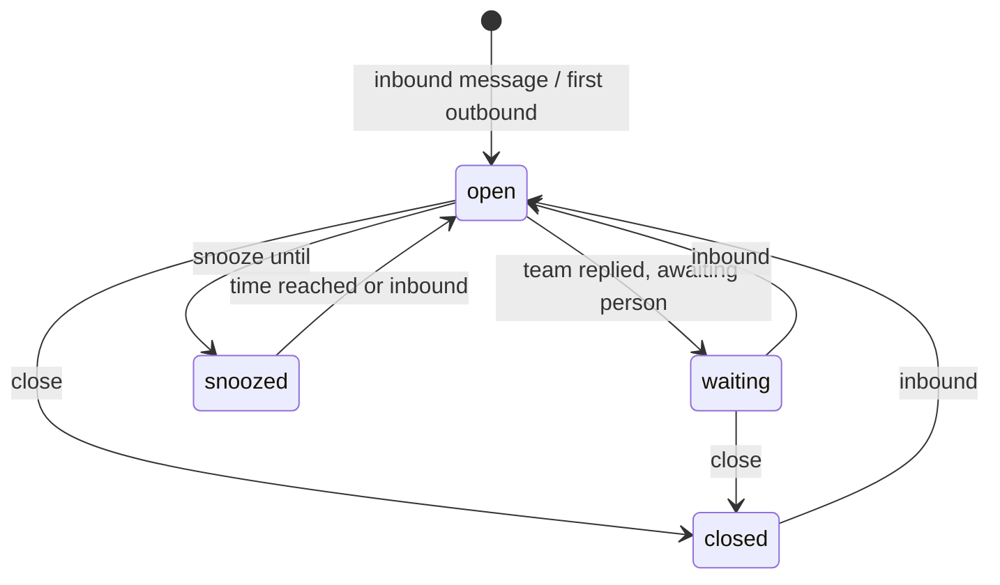
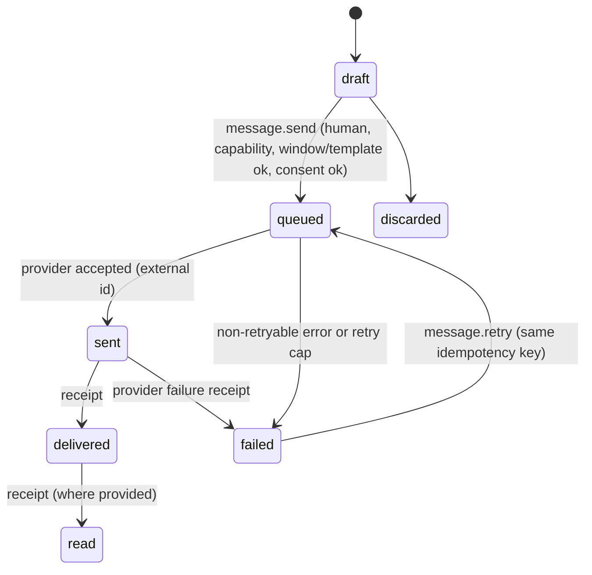
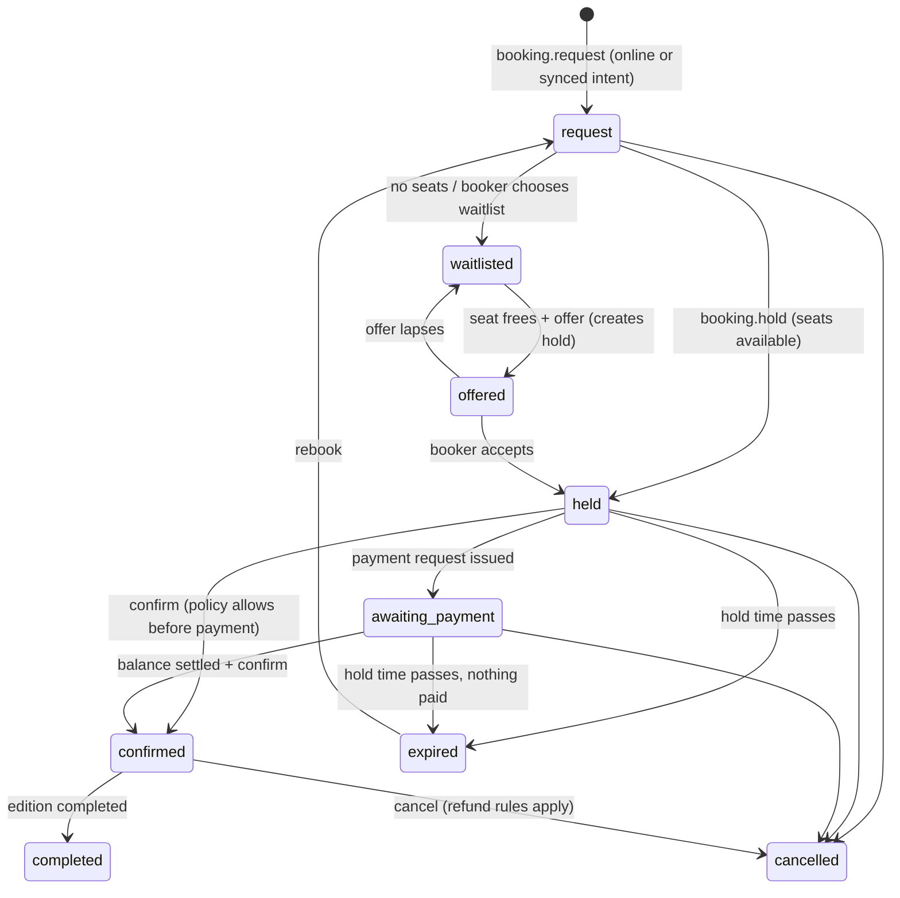
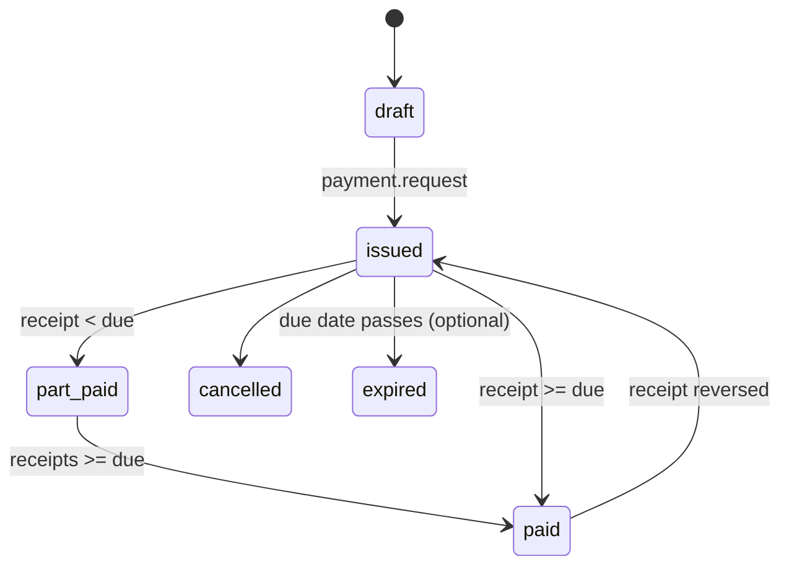
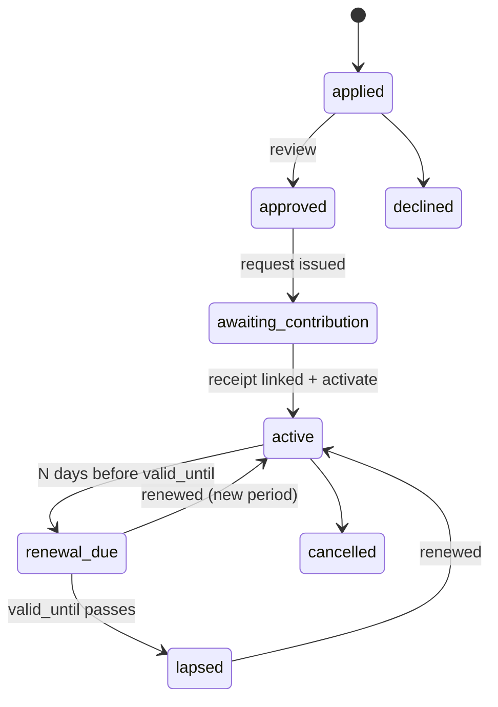

# Communications, bookings and money: transactional specification

Meta provider facts below come from Meta's public developer documentation as of November 2026 and can change. Zoho Mail facts (section 1.7) were not checked in this pass and are all marked [needs verification]. Nothing here implies TCG has, or has applied for, any provider account other than the Zoho Mail mailbox the owner confirmed (A-22).

## 1. Communications

### 1.1 Channel phases

| Phase | Channel | Inbound | Outbound | Prerequisites (owner and provider) |
|---|---|---|---|---|
| C1 | Website forms (existing) | Signed relay ingest | Replies via email (C2) | Already built |
| C1 | Manual logging | Calls, meetings, visits, WhatsApp-app conversations pasted or summarised | n/a | None |
| C2 | Email (contact@ mailbox on Zoho Mail, A-22) | Scheduled polling of the Zoho Mail API (push only if verified) | Send as contact@ through Zoho | Zoho account details (O-20); API access enabled; domain DNS (SPF, DKIM, DMARC) for Zoho verified by the owner |
| C3 | WhatsApp Business | Cloud API webhook | Free-form inside the customer service window; approved templates outside | Meta business verification, WhatsApp Business Account, phone number decision (O-04), template approvals |
| C4 | Instagram professional account | Messaging webhook | Replies inside the standard window; Human Agent tag for manual replies later | Meta app review for messaging permissions; Page linked |
| C4 | Facebook Page | Messenger webhook | Same model as Instagram | Same app |

Why this order: email is the channel most enquiries already use (every website form collects email), it has no messaging window, and it exercises the full conversation model. WhatsApp has the highest operational value (workshop bookings are currently handled on WhatsApp per the project's operating notes) but has the most provider prerequisites, and moving the current number to the API may change how the team uses it today.

### 1.2 Provider windows (from Meta documentation)

- **WhatsApp:** when a user messages or calls, a 24-hour customer service window opens and resets with each user message; free-form ("service") messages can be sent only while it is open; outside it, only pre-approved templates. Meta announced pricing changes; costs must be checked before activation.
- **Instagram and Messenger:** a 24-hour standard messaging window from the person's message; a Human Agent tag allows a person (not automation) to reply up to 7 days later; a third-party summary of Meta's 28 September 2026 changelog says conversations started from click-to-message ads get a window of up to 7 days (verify against Meta's policy page before relying on it).

The adapter computes window state from `last_inbound_at` and the provider's rules; the composer shows it (`08` section 8).

### 1.3 Conversation and message states

### 1.4 Sending rules

1. Only a person with `crm.send:<channel>` can move a draft to queued, in the CRM UI, by an explicit action.
2. Pre-send checks in the same batch: conversation exists and is readable; consent for the purpose is not withdrawn; window open or template approved; channel account connected; recipient endpoint active.
3. The outbox item is created atomically with the queued state. The first attempt runs immediately (`waitUntil`); retries back off exponentially with a cap (proposal: start at 1 minute, cap at 1 day, at most 10 attempts, matching the website relay's policy in the integration contract section 9). After the cap the message is Failed and appears in a review list.
4. Provider idempotency: email providers that support idempotency keys get the message ID; for providers without them, the adapter checks for an existing external ID before resending, and an unknown outcome after a timeout goes to review instead of blind resend.
5. A sent message cannot be undone. Corrections are new messages.
6. Rate limits: per channel account, from provider responses (`rate_limited`); the outbox slows that account only.
7. Attachments: stored in R2 through the existing file pipeline; size and type limits come from each provider and are enforced before queueing.

### 1.5 Inbound processing

1. Verify signature; reject unsigned or stale requests.
2. Insert into `crm_inbound_events` with the provider event ID (unique). Duplicate delivery is acknowledged and ignored.
3. Acknowledge quickly; process in the same request when within budget, otherwise via the cron sweep.
4. Find or create the conversation by (channel account, external thread ID).
5. Identity: exact endpoint match links the person; otherwise the conversation is Unmatched; if two people share a signal, Ambiguous with candidates. Never auto-create a duplicate person when a likely match exists.
6. Status receipts update message status; out-of-order receipts never move a status backwards (read beats delivered beats sent).
7. Opt-out signals (STOP keywords where configured, provider opt-out events, unsubscribe) append a withdrawn consent row and cancel queued non-transactional messages to that endpoint.
8. Visitor content is stored as data; it is never interpreted as instructions by automations or AI (S-11).

### 1.6 Follow-ups and sequences

- Follow-ups are Activities with due dates; Home shows them.
- Automated sequences are deferred. If added later: each step is a draft created for a person to send, or a template send only where consent allows; any inbound reply, opt-out or booking state change stops the sequence. No pressure cadences (S-01).

### 1.7 Email specifics: Zoho Mail adapter (A-22)

contact@thecommonground.living is hosted on Zoho Mail. Zoho stays the mailbox of record: the team can keep using Zoho's own clients, and the CRM mirrors the conversations it needs. Nothing below assumes Gmail behaviour (Gmail thread IDs, history IDs, Pub/Sub push, label semantics). Every statement about Zoho is marked **[needs verification]** and must be checked against Zoho's current developer documentation, and against the actual account, before S5 starts. Nothing here was verified in this pass.

**Options**

| | (A) Zoho Mail REST API (OAuth 2.0) | (B) IMAP for inbound, SMTP submission for outbound |
|---|---|---|
| Runtime fit | Plain `fetch` from the Worker, short bounded calls inside the 15-minute cron (`wrangler.jsonc:49`) or a send request | Needs Workers outbound TCP sockets with TLS for IMAP and SMTP [needs verification: socket support and blocked ports on Cloudflare]; no IMAP IDLE (Workers do not hold long connections), so polling only; an IMAP client and MIME parser to carry in the Worker |
| Credentials | OAuth client ID and secret plus a refresh token in Worker secrets; short-lived access tokens obtained per run [needs verification: token lifetime, refresh flow, scopes] | Mailbox password or app-specific password in a Worker secret [needs verification: whether Zoho requires app passwords with two-factor sign-in and whether IMAP/SMTP must be enabled per account] |
| Host | Data-centre-specific API and accounts hosts (for example `.com`, `.in`, `.eu`) [needs verification; depends on the account, O-20] | Data-centre-specific IMAP/SMTP hosts [needs verification] |
| Inbound | List or search messages in a folder since a cursor; fetch content and attachments by message ID [needs verification: endpoints, paging, sort order, change tokens] | `UID SEARCH` since the last UID per folder; UIDVALIDITY changes force a resync |
| Push | Unknown. Zoho may offer webhooks or similar notifications for Mail [needs verification: availability on the account's plan, signing, retries]. The design does not depend on it | None |
| Outbound | Send-message endpoint as the mailbox [needs verification: whether sent mail is saved to Sent, reply/thread parameters, attachment upload, size limits] | SMTP submission; the CRM must append to Sent by IMAP itself if the team wants it there |
| Threading | Provider thread or conversation identifier if exposed [needs verification]; otherwise RFC 5322 `Message-ID`, `In-Reply-To`, `References` | RFC 5322 headers only |
| Idempotency | No idempotency key assumed [needs verification] | None |
| Limits | Rate limits and daily sending limits per plan [needs verification] | Per-plan SMTP limits [needs verification] |

**Recommendation (P-23): (A), with (B) as a fallback** if the API turns out not to be available on the account's plan. Reasons: no socket or protocol code in the Worker, OAuth scopes instead of a mailbox password, smaller failure surface. (C), Cloudflare Email Routing, is not available while Zoho holds the domain's MX records.

**Design, independent of option**

1. `provider: 'email_zoho'` adapter implementing `poll` and `send` (`07` section 7), off by default, plus the `simulated` adapter under `WORKSPACE_ENV=local-test` for every test and the demo.
2. **Inbound by polling.** The cron run claims a lease on the channel account, calls `poll(cursor, limit)` with a fixed limit per run, inserts each message into `crm_inbound_events` keyed by the provider message identifier (dedupe), advances the cursor in the same batch, and processes within the 45-call budget; remaining work continues next run. Polling frequency is O-21 (the existing cron runs every 15 minutes).
3. **Thread matching** in this order: provider thread identifier (if verified); else `In-Reply-To`/`References` against `crm_messages` Message-IDs the CRM sent or received; else a new conversation. Never match on subject alone.
4. **Outbound.** The CRM generates the `Message-ID` itself and stores it before sending, so a retried send with the same Message-ID can be recognised on the next poll. Because no provider idempotency key is assumed, a timeout or ambiguous response is `unknown` and goes to review (rule 4 in section 1.4); a person checks the mailbox before retrying.
5. **Sent copies.** If the API does not save sent mail to Zoho's Sent folder [needs verification], the team will not see CRM replies in Zoho; decide in O-20 whether that matters.
6. **Mail sent from Zoho directly** (outside the CRM) arrives through polling of the Sent folder, if polled, as `direction: out` messages with `author_id` null, so the timeline stays complete. Whether to poll Sent is part of O-20.
7. **Attachments** go to the existing file pipeline. R2 is not enabled at the pinned config (`wrangler.jsonc` keeps `r2_buckets` commented out and `FILE_STORAGE` is `d1`), and the 20 MB per-file limit applies in both modes (`worker/fileStore.ts:26`); larger attachments stay in Zoho with a link and a "kept in mailbox" note.
8. **Egress** to the exact Zoho hosts for the account's data centre only, `redirect: 'error'`, no fallback.
9. **Separation from Workspace email.** Workspace's own email (`worker/email.ts:14-19`: Resend, or the simulated sink under local test) keeps sending account verification, notifications and digests to Workspace users. The Zoho adapter is a separate CRM channel and never replaces it.

**Common rules**

- One shared mailbox identity for the team (contact@), plus optional personal mailboxes later.
- No open or click tracking by default (P-16, still Proposed).
- Website form replies: the reply-to address from the submission becomes an endpoint; the reply is a normal outbound email in the conversation linked to the submission.

## 2. Bookings

### 2.1 Booking states

### 2.2 Capacity rules

- Seats in use = confirmed allocations + unexpired holds.
- `booking.hold` and `booking.confirm` allocate with one conditional insert whose predicate recomputes seats in use inside the same D1 batch (ADR-08). Zero rows inserted means `capacity_exceeded`.
- Capacity can be lowered only to at least the confirmed seats; held seats over the new capacity are listed for a person to resolve.
- Group bookings hold all seats or none.
- Transfers between editions are one batch: allocate in the target, release in the source.

### 2.3 Failure cases and handling

| Case | Handling |
|---|---|
| Two people confirm the last seat at once | One succeeds; the other gets `capacity_exceeded` with the current count and options (waitlist, fewer seats) |
| Payment arrives after the hold expired | Ledger records the receipt; booking moves to a "paid, no seat" review state; a person decides (allocate if seats exist, waitlist, or refund). Mirrors the relay's Patron `refund_needed` handling |
| Payment arrives twice | Second receipt recorded; balance shows credit; refund request created for review |
| Offline booking request | Saved as an intent; on sync the server creates a request (not a hold); the coordinator sees the result |
| Edition cancelled | All active bookings move to cancelled with reason; refund requests created per policy for review; messages drafted, not sent |
| Participant unnamed at confirmation | Allowed as placeholder; pre-arrival list shows placeholders as missing |
| Screening "not suitable" | Booking stays held; a person decides and drafts the message; screening content never appears in the message automatically |

### 2.4 Attendance

Per participant per session date: present, absent, partial. Completion of an edition marks unrecorded attendance as "not recorded", not absent.

## 3. Money

### 3.1 Representation

- Integer minor units plus ISO 4217 currency on every amount. Minor-unit exponent from `Intl.NumberFormat(...).resolvedOptions().maximumFractionDigits`, as `shared/finance.ts` already does for summaries.
- No floating-point money in operational tables. Display conversion only at the edge.
- No exchange conversion; multi-currency totals are shown per currency.

### 3.2 Objects and states

Refund requests: requested -> approved (if needed) -> issued (evidence recorded) or rejected.

### 3.3 Rules

1. Ledger entries are append-only (SQL triggers block UPDATE and DELETE). Corrections are reversals with a reason.
2. A receipt needs evidence: provider event ID (phase 2), or proof file plus recorder, or bank reference. Recording a receipt never happens from a message, a note or a stage change.
3. Idempotency: provider events dedupe by provider event ID; manual receipts by request ID.
4. Refund approval: above a threshold (O-09), a second person with `crm.refund.approve` approves; nobody approves their own request.
5. Reconciliation (phase 2): provider settlement reports compared with ledger entries; unmatched items listed for a person; nothing auto-corrected.
6. Receipts as documents (phase 2): numbering and wording are owner and legal decisions (O-10). Until then the CRM shows payment confirmations, not statutory receipts or invoices.
7. Accounting boundary: the CRM is an operational ledger; exports go to the external accounting system. GST or other tax treatment is not computed in-app.
8. Foreign currency and foreign contributors: blocked by default in the Money engine until you confirm the rule with qualified advice (C-03, O-14).

### 3.4 Payment provider (phase 2)

The website relay already uses Razorpay for Patrons. Reusing the same provider for bookings and memberships would keep one account, but a new integration still needs its own webhook secret, idempotency and reconciliation in the CRM (O-11). Payment links are created by a command; the webhook is the only source of "paid" for provider payments.

## 4. Membership

Benefit redemption (contribution usable against eligible bookings) would be a ledger credit allocated to a booking's payment request by a person, never automatic, and only after the rule is confirmed (O-07).

## 5. Merge

Merge (`person.merge`) runs in bounded batches if a person has many references; the merge journal records every moved reference so unmerge can restore them. A merge that would exceed the request budget returns `budget_exceeded` with a plan to complete in steps, each step idempotent.
