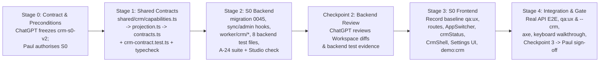

# S0 plan: rails and access

Slice S0 from [`11-ROADMAP.md`](11-ROADMAP.md). **Status: revised plan for review and approval (`crm-s0-v2`, closing CR-01 to CR-06).** Nothing in application source (`src/`, `shared/`, `worker/`, `migrations/`) has been implemented yet, and implementation has not been authorised. Workspace baseline: `38c388ac1787b0ff14e8e26d7abd1bf8c6bd0444` on branch `crm/foundation` ([`00-README.md`](00-README.md)). Owner decisions applied: A-19 to A-26 ([`01-DECISIONS.md`](01-DECISIONS.md)). No commit of code, remote migration, permission activation, provider connection or deployment is part of this plan; each requires separate authorisation.

## 1. Outcome

When S0 is done:

1. With `CRM_ENABLED` off (the default), Workspace UI behaves and renders pixel-identically to the baseline (`npm run qa:ux` passes with zero diff pixels), existing tests pass under the A-24 rule (section 8.4), and `npm run demo:studio -- --check` passes. By design (`CR-05`), three Workspace-hardening security controls remain active even when `CRM_ENABLED` is off: server-side owner protection (A-23 / SC-6), disable-time CRM grant revocation (A-25 / SC-7), and unconditional rejection of `_crm_` projection keys outside registered commands (ADR-04 / SC-3).
2. With `CRM_ENABLED` on, the owner and accounts holding `crm.access` see an app switcher and the CRM shell at `/crm` (Home empty state, Settings). Accounts without `crm.access` see no switcher, `/crm` shows the access-denied state, and operational `/api/crm/*` routes (other than `/status`) refuse them.
3. The owner, and admins to whom the owner grants `crm.access` + `crm.capabilities.manage`, grant and revoke CRM capabilities in **Settings → Accounts and capabilities**; every state change is audited append-only (A-21).
4. Disabling an account revokes its CRM capabilities with audit records in the same atomic batch; re-enabling restores none (A-25).
5. Ordinary admins cannot demote, disable or remove the owner; enforced server-side with both pre-check and batch SQL fence (A-23).
6. A transactional command framework exists with canonical request hashing, idempotency replay and recovery, atomic records-or-server-only commit (`flushAtomicCommit`), authority/revision fences and journal, exercised by `capability.grant` / `capability.revoke` and test-only projection commands.
7. `_crm_` projection keys are rejected item-wise for every non-command write, in both Workspace permission modes (`access_state.enabled = 0` and `1`).

Not in S0: People grid, endpoints, pack upgrade, MCP tools, `crm_intents`, any provider adapter, any CRM table beyond the three in section 6.2.

## 2. Responsibilities and governance (revised A-26)

| Party | Role in S0 | Boundaries |
|---|---|---|
| **Neon** (principal engineering agent in T3 Code) | Technical architecture refinement, normative shared TypeScript contracts (`shared/crm/*`), database migrations, backend implementation, server-side security & authorisation, APIs, transactional command infrastructure, frontend implementation (backend-first in Stage 3), UI/UX quality, unit/D1/UX-lab/regression tests, and engineering docs/progress reporting (`PROGRESS.md`). | Does not override owner decisions (A-01–A-25), activate permissions, touch production data/remotes, or proceed past review gates without approval. |
| **ChatGPT** | Central project management, requirements coordination and independent review: reviews and freezes `crm-s0-v2`, reviews Stage 2 backend & security diffs (Checkpoint 2), and reviews final S0 integration & acceptance evidence (Checkpoint 3). | Does not implement or approve changes to owner decisions (Paul's authority). |
| **Paul** | Owner decisions (A-*), approval of `S0-PLAN.md` & implementation authorisation (G0/S0), and later staging/provider/production gates (`11-ROADMAP.md` section 4). | — |

**Contract & architecture change procedure:**

1. If implementation uncovers a needed contract or architecture change, stop modifying the affected interface and document a change request (what, why, repository evidence, security/frontend impact).
2. ChatGPT reviews it against the specification and `AGENTS.md` invariants.
3. If accepted, Neon updates [`contracts/crm-s0-v2.md`](contracts/crm-s0-v2.md) and bumps the version (`crm-s0-v3`). Any change altering an owner decision, security invariant, authority model or an already-applied migration requires Paul's approval recorded in [`01-DECISIONS.md`](01-DECISIONS.md).
4. Re-run `tests/crm-contract.test.ts` and affected backend/frontend suites against the new version before continuing.

## 3. Shared contracts (`CR-06` single source)

**The normative text is [`contracts/crm-s0-v2.md`](contracts/crm-s0-v2.md)** (candidate, resolving CR-01 through CR-06, pending ChatGPT review & freeze). Where this plan and the contract document ever differ, `crm-s0-v2.md` wins.

| ID | Contract | Code artefact (single source authored by Neon in Stage 1) |
|---|---|---|
| SC-1 | Command envelope, canonical SHA-256 hash (`name`, `via`, normalised `input`, sorted `expected`), idempotency replay & journal recovery, no-op journalling, error persistence rules, error codes, `requestId` (`[A-Za-z0-9_-]{8,64}`) | `shared/crm/contracts.ts`: TypeScript interfaces, bounds, error maps and Zod schemas |
| SC-2 | Capability catalogue (13 capabilities), labels, `crm.access` mandatory gate over specialised grants, single-snapshot protected read rules, client invalidation (`crmStatusStore`) | `shared/crm/capabilities.ts`: pure catalogue, `isCrmCapability`, labels (no auth logic; server rules live in `worker/crm/rules.ts` and `grants.ts`) |
| SC-3 | Projection key rule (`_crm_` on `tasks` only via static `ProjectionGrant`), unconditional item-wise rejection, and atomic single-batch `flushAtomicCommit` (`strictExpectationGuard`, `changes() = 1`, SQL `projections` rev capture, no retries) | `shared/crm/projection.ts`: `CRM_PROJECTION_PREFIX`, `isCrmProjectionKey`, `ProjectionGrant` |
| SC-4 | CRM HTTP API (`/status`, `/commands/:name`, `/read/capabilities`, `/read/capability-audit?cursor=`), exact validation precedence (`401 -> 404 -> 413 -> 400 -> 200`), streamed body cap (`65,536` bytes), `effectiveAccess` on overview, Zod response parity | Zod schemas in `shared/crm/contracts.ts` |
| SC-5 | `capability.grant` / `capability.revoke` 15-step deterministic precedence (`not_admin` grant-only), wire vs strict input schemas (`unknown_capability` / `unknown_scope`), 3 mandatory batch fences, no-op journal commit, `pokeLive()` | Types & wire/strict schemas in `shared/crm/contracts.ts` |
| SC-6 | Owner protection on account routes: `403 { error: 'owner_protected' }` (always active regardless of `CRM_ENABLED`) | `OWNER_PROTECTED_ERROR` in `shared/crm/contracts.ts` |
| SC-7 | Disable revocation in `POST /api/users/:id/disable` batch; enable writes nothing to CRM tables (always active regardless of `CRM_ENABLED`) | Server behaviour (`worker/admin.ts`) |
| SC-8 | SQL contract for `crm_commands` (incl. `status` and 16,384 UTF-8 byte `CHECK`), `crm_capability_grants`, `crm_capability_audit` + append-only triggers | `migrations/0045_crm_foundation.sql` |
| SC-9 | `CRM_ENABLED` semantics (`'1'`/`'true'`) and exact split between flag-gated UI/routes vs always-on Workspace security hardenings | `Env.CRM_ENABLED` (`worker/auth.ts`) + `GET /api/crm/status` |

## 4. Backend-first execution sequence & cross-cutting boundaries (`CR-06`)

There is no separate Opus-to-Neon contract handoff and no mandatory standalone prototype gate. Implementation proceeds sequentially in four gated stages, with independent ChatGPT review checkpoints between backend and frontend so neither side is built against unverified assumptions:



### 4.1 Exact creation & validation sequence for `shared/crm/*` (Stage 1)

Create and validate the shared contract layer **before** writing any `worker/crm/*` or `src/apps/crm/*` file, in this exact order:

1. `shared/crm/capabilities.ts` — pure constants (`CRM_CHANNELS`, `CRM_CAPABILITIES`, `ALL_SCOPE`, `PROGRAMME_SCOPED`, `CRM_CAPABILITY_LABELS`) and `isCrmCapability`. Imports nothing from `worker/` or `src/`.
2. `shared/crm/projection.ts` — `CRM_PROJECTION_PREFIX`, `isCrmProjectionKey`, `ProjectionGrant`. Imports nothing from `worker/` or `src/`.
3. `shared/crm/contracts.ts` — imports `./capabilities` and `zod`; defines `CRM_CONTRACT_VERSION = 'crm-s0-v2'`, bounds, `CRM_ERROR_CODES`, `CRM_ERROR_RETRYABLE`, `OWNER_PROTECTED_ERROR`, all public TS interfaces, and all strict/wire Zod schemas (`CommandRequestEnvelopeSchema`, `commandResultSchema`, `CommandErrorSchema`, `CrmStatusSchema`, `CapabilityOverviewSchema`, `CapabilityAuditPageSchema`, `CapabilityChangeRequestInputSchema`, `CapabilityChangeInputSchema`, `CapabilityChangeOutputSchema`).
4. Validate Stage 1 immediately with:
   - `tests/crm-contract.test.ts` (verifies 13 capabilities, unique labels, retryability map completeness, wire vs strict schema behaviour for `unknown_capability`/`unknown_scope`, envelope rejection of >100 `expected` keys or invalid `requestId`, response schema roundtrips), and
   - `npm run typecheck` (`tsc --noEmit` across `shared/`, `worker/`, `src/`, `tests/`).

### 4.2 Workspace files touched & review boundaries

Every change outside `shared/crm/`, `worker/crm/`, `src/apps/crm/` and `docs/crm/` is bounded to the files below and receives line-by-line independent review by ChatGPT at Checkpoints 2 and 3:

| File | Stage | Purpose | Invariant / Review Focus |
|---|---|---|---|
| `worker/sync.ts`, `worker/mutationAccess.ts` | Stage 2 | `ApplyOptions.projection` & `.commit`; unconditional `_crm_` pre-check; `flushAtomicCommit` + `strictExpectationGuard` | Preserves `expectationGuard` for `tests/sync-atomic.test.ts:44`; zero behavioural change for existing callers; ChatGPT line-by-line review |
| `worker/admin.ts` | Stage 2 | SC-6 owner protection on 3 routes; SC-7 disable-time CRM grant revocation | Always active regardless of `CRM_ENABLED`; compatible with `tests/phase7-disable-d1.test.ts`; ChatGPT line-by-line review |
| `worker/index.ts`, `worker/auth.ts` | Stage 2 | Mount `/api/crm` before `/api` (`worker/index.ts:123`); add `Env.CRM_ENABLED?: string` (`worker/auth.ts:10`) | No change to auth/middleware order for existing routes |
| `scripts/certification/migrations.json`, `scripts/access/selftest.mjs`, `scripts/certification/test-files.mjs`, `scripts/certification/test-files.test.mjs` | Stage 2 | Register `0045`; un-hardcode `0044` in `selftest.mjs:33`; include `crm` & `admin-owner-protection` D1 tests in `d1TestFiles` | Keeps certification harness green |
| `src/routes.tsx`, `src/App.tsx` | Stage 3 | Extract `routes` cleanly and mount lazy `crm/*` top-level `RequireAuth` route | Existing routes & `AccountSwitchGate` untouched |
| `src/core/shell.tsx`, `src/core/AppSwitcher.tsx`, `src/core/crmStatus.ts` | Stage 3 | Replace static logo block (`src/core/shell.tsx:483-488`) with `<AppSwitcher fallback={...}/>` | Pixel-identical Workspace when `CRM_ENABLED` off or no `crm.access`; `AppSwitcher` imports nothing from `src/apps/crm` |
| `package.json`, `scripts/qa-ux.mjs`, `scripts/ux-lab/crm-shell.spec.mjs`, `scripts/crm-demo/*` | Stage 3 | Add `demo:crm` script and `--crm` UX lab gate | Existing `qa:ux` without `--crm` unchanged |

Unchanged by design: `shared/collections.ts`, `src/core/db.ts`, `src/sw.ts`, `src/index.css`, all Workspace feature modules, `templates/*.json`, `wrangler.jsonc`, `docs/integrations/the-common-ground.md`.

## 5. Preconditions: Local Development vs Production Activation (`CR-06`)

Local development on disposable fixtures and production activation have distinct preconditions so production-only access checks do not block local engineering:

### 5.1 Local development & S0 start preconditions (must hold before Stage 1/2)

1. **Contract freeze**: Independent review of [`contracts/crm-s0-v2.md`](contracts/crm-s0-v2.md) recorded by ChatGPT.
2. **Owner S0 authorisation**: Paul approves S0 plan and authorises local S0 implementation (code changes stay uncommitted or on `crm/foundation` until review/commit authorisation).
3. **Clean Workspace baseline reference**: Verified against `38c388a` (`2,227 passed / 3 SI-01 failed / 2,230 total`, `typecheck`, `build`, `demo:studio -- --check`).
4. **Local owner assumption**: Disposable Miniflare/Playwright fixtures always bootstrap a fresh local database where the first signup creates the single active `owner` (`worker/auth.ts:316`). No production export is needed to implement or test S0 locally.
5. **UX screenshot baseline (before Stage 3 frontend edits)**: Run `npx playwright install chromium firefox webkit` (if missing) and `npm run qa:ux -- --record` into `.artifacts/ux-lab/baselines/` before editing any file under `src/`.

### 5.2 Production activation preconditions (do NOT block local S0; required before G4–G6)

1. **Production owner verification (read-only)**: On an owner-exported copy of production D1, confirm `SELECT id, username, COALESCE(workspace_role, role) FROM users WHERE disabled_at IS NULL` has **exactly one** active `'owner'` and that it is Paul's account (migration `0012_phase5_access_foundation.sql:37-39` promoted the earliest-created admin on legacy DBs). S0 builds no ownership transfer; if production differs, Paul corrects it via a reviewed step before `CRM_ENABLED` is turned on remotely.
2. **Production inventory**: Check installed pack version, pinned People database ID (`website_ingest_grant.people_id`), and duplicate-email count in People (required before S1 backfill, not S0).
3. **SI-01 stabilisation**: Investigate and stabilise the three flaky Workspace D1 tests before production release (A-24; tracked in [`12-OPEN-DECISIONS.md`](12-OPEN-DECISIONS.md)).
4. **Channel / storage / physical-device gates**: Private R2, Zoho verification (O-20, O-21), and physical device / human AT checks per slice (`11-ROADMAP.md` section 5).

## 6. Stage 1 & Stage 2 — Shared contracts & S0 Backend (`CR-01`–`CR-05`)

### 6.1 Migration `migrations/0045_crm_foundation.sql` (SC-8)

Create `migrations/0045_crm_foundation.sql` with the exact DDL in [`contracts/crm-s0-v2.md`](contracts/crm-s0-v2.md) SC-8 (`crm_commands` with `status` + 16,384 UTF-8 byte `CHECK`, `crm_capability_grants`, `crm_capability_audit` + both append-only triggers).

- Register `0045_crm_foundation.sql` with its SHA-256 in `scripts/certification/migrations.json` (otherwise `scripts/certify-phase4.mjs:181` fails).
- Update `scripts/access/selftest.mjs:33` from hard-coded `'0044_history_body_context.sql'` to `verifyMigrationManifest().at(-1).name`.
- Update `scripts/certification/test-files.mjs:3` to `(?:phase(?:[4-9]|1[0-3])|audit|assistant|crm|admin-owner-protection)-.*-d1\.test\.ts$` and add a matching assertion in `scripts/certification/test-files.test.mjs`.
- Test locally with `npm run db:migrate:local` (never remote).

### 6.2 Exact changes to existing Worker code (`CR-02`, `CR-03`, `CR-05`)

**1. `worker/sync.ts`**

- Add to `ApplyOptions` (`worker/sync.ts:158-194`):
  - `projection?: ProjectionGrant;` (set only by `worker/crm/commands.ts`).
  - `commit?: (recordIds: string[]) => D1PreparedStatement[];` (requires `atomic: true`).
- Extend `ApplyResult` (`worker/sync.ts:225-239`) with optional `fenceAborted?: boolean;` so callers distinguish a SQL `malformed JSON` fence abort from a pre-check conflict.
- At `worker/sync.ts:309`, keep early empty return **only** when `!incoming.length && !opts.expect?.size && !opts.commit` (so server-only or empty-record expectation commits are never skipped).
- Validate `opts.commit` invariants early: if `opts.commit && opts.atomic !== true` throw `Error('commit requires atomic: true')`; if `opts.commit && (opts.journal || opts.execution || env.MCP_PLAN)` throw `Error('commit cannot be combined with changesets, execution, or MCP_PLAN')`.
- Immediately after cloning patches (`worker/sync.ts:350`) and **before** `if (snapshot.enabled === 1 || env.CONNECTOR)` (`:353`), run unconditional item-wise `projectionRejections(incoming, opts.projection)`:
  - Any item patching a `_crm_*` key without a matching `opts.projection` key on `collection === 'tasks'` is rejected item-wise (`reason: 'protected_field'`) and filtered out of `incoming` (keeping `rejected === rejectedItems.length` consistent even if multiple mutations share an `id`).
  - If any item is rejected and `(opts.atomic === true || (!!opts.expect?.size && opts.atomic !== false))`, return `{ rejected, rejectedItems, changed: 0, applied: [] }` immediately without calling `opts.commit`.
- Pass `opts.projection` to `authorizeMutations` (`worker/sync.ts:355`).
- In `checkExpectations` / planning (`worker/sync.ts:436-446`): when `opts.commit` is present and `conflicts.length > 0`, return before invoking `opts.commit`; also ensure `changedPlans.length + expectedNotInChanged <= MAX_EXPECTED`.
- **Dedicated `flushAtomicCommit(...)` when `opts.commit` is set** (separate from `flushPlans` at `:526`, leaving legacy callers untouched):
  - Never retries (`MAX_ATTEMPTS = 1`), never splits into multiple chunks.
  - Runs even when `changedPlans.length === 0` (covering read-only `opts.expect` and idempotent unchanged projections).
  - Builds `guardExpect = new Map<string, number>()`: sets `(id, expectedRev)` for all `opts.expect` entries and `(p.id, p.baseSeq)` for any `changedPlans` item not already in `opts.expect`.
  - Uses `strictExpectationGuard(db, guardExpect)`:
    ```sql
    SELECT CASE WHEN (
      SELECT COUNT(*) FROM json_each(?) e LEFT JOIN records r ON r.id = e.key
      WHERE COALESCE(r.seq, -1) <> e.value
    ) = 0 THEN 1 ELSE json_extract('{', '$') END
    ```
    Note: legacy `expectationGuard` (`worker/sync.ts:515-523`) remains untouched so `tests/sync-atomic.test.ts:44` (`FakeD1` matching `/JOIN json_each\(\?\)/`) does not break.
  - Statement order inside the single `db.batch(statements)`:
    1. `writeAuthorityFences(db, authority)` (if `authority` present), OR `SELECT CASE WHEN (SELECT enabled FROM access_state WHERE id = 1) = 0 THEN 1 ELSE json_extract('{', '$') END` when `!authority` (prevents Track A activation mid-flight from bypassing `authorizeMutations`)
    2. `opts.fences` (if present — runs `actorFence`, `capabilityFence`, command fences BEFORE any writes)
    3. `strictExpectationGuard(db, guardExpect)` (if `guardExpect.size > 0`)
    4. For each `p` in `changedPlans`:
       - existing `approvalGate` SQL guard when `p.collection === 'tasks'` (`worker/sync.ts:577-586`)
       - `stmtFor(p)`
       - **`SELECT CASE WHEN changes() = 1 THEN 1 ELSE json_extract('{', '$') END`** (strict per-record write assertion — guarantees 0-row projection update aborts the entire batch!)
       - `historyStatement(...)` when `p.collection !== 'activity'` (excludes `_crm_` per `worker/historyPersistence.ts:3`)
       - `stageAppliedEvent(...)` when `opts.event` is set
    5. `...opts.commit(changedPlans.map(p => p.id))` (executes operational rows + `crm_commands` journal `INSERT` last; journal statement reads committed `seq` values from `records` via `json_set` / `json_group_array` when `changedPlans.length > 0`).
  - Batch error handling in `flushAtomicCommit`:
    - If `err instanceof D1BudgetExhausted` -> rethrow directly (`503 processing_budget`).
    - If `err instanceof Error && /malformed JSON/i.test(err.message)`: return `{ rejected: 0, changed: 0, applied: [], conflict: true, fenceAborted: true }` without burning extra `readRows` or hydrating un-gated `ConflictInfo` records (let `runCommand`'s single post-abort batch decide `401` / `forbidden` / replay / `idempotency_conflict` / `stale`).
    - For ALL other SQLite/D1 errors (e.g., `UNIQUE`, `CHECK`, `FOREIGN KEY`, transient D1 error) -> **rethrow** to `runCommand` rather than swallowing into `partialError`.

**2. `worker/mutationAccess.ts`**

- Add optional trailing parameter `projection?: ProjectionGrant` to `authorizeMutations` (`worker/mutationAccess.ts:48`).
- In the protected-field loop (`:65-68`), allow `field` when `!!projection && ch.collection === 'tasks' && isCrmProjectionKey(field) && projection.keys.has(field)`, while keeping all existing space edit/read and dependency checks active.

**3. `worker/admin.ts` (`CR-05`: ALWAYS ACTIVE regardless of `CRM_ENABLED`)**

- **Owner protection (A-23 / SC-6)**:
  - In `POST /users/:id/disable` (`:108-124`), `PATCH /users/:id` (`:165-179`), and `DELETE /users/:id` (`:206-215`), after loading `before = await accountState(c.env, target)`: if `before.canonicalRole === 'owner' && target !== actor.id`, return `c.json({ error: OWNER_PROTECTED_ERROR }, 403)` before any batch — explicitly placed **before** `:172` (so `PATCH { role: 'admin' }` on an owner returns `403`, not `200`) and **before** `already` at `:111`.
  - Extend `accountFence` (`:103-105`) with optional `protectOwner = false` adding `AND COALESCE(workspace_role, role) != 'owner'` inside the `EXISTS(...)` predicate on all three routes as a race backstop (`409 account_or_authority_changed`).
  - Keep existing self-change checks (`:109,169,208`) and `protectLast` unchanged.
- **Disable-time CRM capability revocation (A-25 / SC-7)**:
  - In `POST /users/:id/disable`, when `!already`, append inside the **same `statements` array** (`:111-118`, before `UPDATE users SET disabled_at`):
    1. `INSERT INTO crm_capability_audit(...) SELECT lower(hex(randomblob(16))), ?1, user_id, 'revoke', capability, scope, json_object('held', 1, 'grantedBy', granted_by, 'grantedAt', granted_at), json_object('held', 0), 'account_disabled', ?2 || '|' || capability || '|' || scope, ?3 FROM crm_capability_grants WHERE user_id = ?4 ORDER BY capability, scope` (`?2 = 'disable|' + crypto.randomUUID()`, avoiding `:` which appears in capability names).
    2. `DELETE FROM crm_capability_grants WHERE user_id = ?4`.
  - In `DELETE /users/:id` (`:210-213`), also add `DELETE FROM crm_capability_grants WHERE user_id = ?` before `DELETE FROM users` (matching `:211`'s explicit `DELETE FROM sessions`).
  - Keep `pokeLive(c.env, c.executionCtx)` on disable, enable, role patch, and delete (`:122,141,178,214`).
  - Note: verified against `tests/phase7-disable-d1.test.ts`: no existing test has a non-owner admin touching an owner (`alice` is owner and performs operations), and the two extra statements sit inside the existing single `db.batch` so the 45-call D1 budget assertion at `:24` is unaffected.

### 6.3 New `worker/crm/*` files

| File | Responsibility |
|---|---|
| `worker/crm/rules.ts` | Pure rules (`evaluateCapability`, `effectiveCapabilitiesForUser`, `canAccessCrmApi`, `canManageCapabilities`, `planCapabilityChange`) implementing SC-2 & SC-5 (incl. `crm.access` prerequisite, `crm.capabilities.manage` + `admin`, owner implicit, 15-step precedence, `not_admin` grant-only). |
| `worker/crm/projection.ts` | Pure `projectionRejections(changes, projection?)` implementing SC-3. |
| `worker/crm/commands.ts` | Per-request `createCommandRegistry(defs)` (validating `projectionKeys` against `/^_crm_[a-z0-9_]{1,59}$/`, zero module-level mutable state) + `runCommand` implementing SC-1 (defensive `CRM_ENABLED` check, recursive `undefined`-stripping before `stableJson` (`shared/stablejson.ts:13-18`), canonical SHA-256 hash w/ `expected` & `via`, pre-commit snapshot batch, coarse-auth before parse, replay auth, 16 KB result cap, server-only & `applyChanges(..., { commit })` paths, commit-error recovery with `401 -> forbidden -> replay/conflict -> stale` precedence, `503 write_interrupted` fallback). |
| `worker/crm/grants.ts` | Single-batch loaders (`COALESCE(u.workspace_role, u.role)` — never `c.get('user').role` from `worker/auth.ts:199-214`), `actorFence`, `targetAccountFence`, `targetGrantStateFence`, `capability.grant` & `capability.revoke` definitions (`pokeLive()` on change), `readCapabilitiesOverview`, `readCapabilityAudit` (`LEFT JOIN users` + base64url cursor validation). |
| `worker/crm/index.ts` | `crmApi` Hono router (`GET /status`, `POST /commands/:name`, `GET /read/capabilities`, `GET /read/capability-audit`, plus `crmApi.all('*', 404 not_found)`) enforcing `SC-4` validation order (`401 -> 404 -> 413 boundedRequestBody -> 400 -> 200 / 403 / 503`). |

### 6.4 Stage 2 Backend Tests (`CR-01`–`CR-05`)

All 8 files are written and run in Stage 2 (plus Stage 1 `tests/crm-contract.test.ts`):

1. `tests/crm-contract.test.ts` (Stage 1) — 13 capabilities, error codes/retryability, strict/wire Zod schemas, `REQUEST_ID_PATTERN`, `expected` bounds.
2. `tests/crm-projection-keys-d1.test.ts` — `_crm_*` rejected item-wise in `access_state.enabled = 0` and `1`; allowed only with matching `ProjectionGrant` on `tasks`; disallowed `_crm_y` or `pages` fails atomically without calling `commit`; non-`_crm_` `_` keys keep legacy behaviour.
3. `tests/crm-mcp-projection-d1.test.ts` — MCP `update_records` rejects `_crm_*` keys in both permission modes; `query_records` still reads.
4. `tests/crm-rules.test.ts` — pure unit tests for all SC-2 & SC-5 rules (`crm.access` prerequisite over specialised grants, `crm.capabilities.manage` + `admin`, demotion, owner implicit, guest ineligible, 15-step precedence, `not_admin` grant-only).
5. `tests/crm-commands-d1.test.ts` — canonical hash sensitivity (`input`, trimmed `reason`, `expected`, `via`, `undefined`-key stripping per `shared/stablejson.ts:13-18`); no-op journalling; error persistence policy (plan errors never insert `crm_commands`); 16 KB `budget_exceeded`; concurrent identical request (both `UNIQUE` collision AND winner-tripping-fence replay recovery); concurrent `idempotency_conflict`; lost-ack recovery; recovery denial precedence (`401` -> `forbidden` -> replay/conflict -> `stale`); unrelated SQL constraint (`CHECK`/trigger) NOT misclassified as replay or `stale`; `flushAtomicCommit` with empty `todo` enforcing read-only `recordExpect` & `strictExpectationGuard` on missing row; `!authority` `access_state=0` fence; `changes() = 1` abort rolling back server-only rows & journal; atomic SQL `projections` rev accuracy; `withD1Budget(env, 45)` compliance.
6. `tests/crm-grants-d1.test.ts` — grant/revoke lifecycle, `already: true` no audit row, `crm.access` gate, 3-fence concurrent race (`stale`), `account_disabled`, `not_admin` on grant vs dormant-grant revoke on demoted member, `unknown_capability`, `unknown_scope`, append-only triggers, `pokeLive()` invoked only on state change, `DELETE /users/:id` explicit grant cleanup + audit retention, both permission modes.
7. `tests/crm-disable-revocation-d1.test.ts` — tested with `CRM_ENABLED` BOTH off and on (`CR-05`): single-batch revoke + audit, failed fence rollback leaves grants/audit untouched, enable restores none, repeated disable UUID uniqueness, already-disabled no-op.
8. `tests/admin-owner-protection-d1.test.ts` — tested with `CRM_ENABLED` BOTH off and on (`CR-05`): non-owner admin `PATCH`/`disable`/`DELETE` against owner -> `403 owner_protected`; owner self-checks; last-privileged fence; concurrent promotion race backstop (`409 account_or_authority_changed`).
9. `tests/crm-api-d1.test.ts` — Zod validation of every response; exact validation precedence (`401 -> 404 -> 413 -> 400 -> 200 / 403`); streamed body > 65,536 bytes without `Content-Length` -> `413`; invalid UTF-8 / JSON -> `400 invalid_body`; unknown capability/scope -> `200 invalid_input`; unauthorised `/read/capability-audit?cursor=bad` -> `403` before `400 invalid_cursor`; valid base64url cursor paging; SC-9 values (`undefined`, `''`, `'0'`, `'false'`, `'1'`, `'true'`, `'TRUE'`); single-snapshot protected read check.

## 7. Stage 3 — Frontend Implementation (after Checkpoint 2 Backend Review)

Built directly against the verified Stage 2 API (still validated against `shared/crm/contracts.ts` Zod schemas in unit tests). Separate clickable prototype is **not** required (revised A-26).

### 7.1 Frontend files

| Action | File | Purpose |
|---|---|---|
| Add | `src/routes.tsx` | Route array extracted from `src/App.tsx` plus lazy `crm/*` route (section 7.2). |
| Change | `src/App.tsx` | Imports `routes` from `src/routes.tsx`; everything else unchanged. |
| Change | `src/core/shell.tsx` | In `SidebarContent` (`:483-488`), wrap logo markup in `<AppSwitcher fallback={...}/>`. No other change. |
| Add | `src/core/crmStatus.ts` | In-memory store for `GET /api/crm/status` implementing all 6 invalidation/refresh triggers in `crm-s0-v2.md` SC-2.3 (bound to `uid`, `token`, `accessClientStore.epoch`, `generation`; `ws-records-changed`, `storage`, `focus`/`pageshow`/`visibilitychange`, `online`, `401 -> dropSession()`, `403`/`forbidden`/`404` demotion handling). |
| Add | `src/core/AppSwitcher.tsx` | Accessible menu button (Workspace, CRM), `aria-haspopup="menu"`, Escape returns focus; renders unchanged `fallback` unless `enabled && access`; imports nothing from `src/apps/crm`. |
| Add | `src/apps/crm/CrmShell.tsx` | Lazy-loaded shell, root `<div data-app="crm">`, rail with Home & Settings (gated by capabilities), Access denied state when disabled or missing `crm.access`; never calls `sendHere('/crm/...')` while permissions are off (`worker/live.ts:52-57`). |
| Add | `src/apps/crm/routes.tsx`, `Home.tsx` | Descendant routes `index`, `settings/access`; Home empty state (`08` section 15). |
| Add | `src/apps/crm/api.ts` | `runCrmCommand(name, input, expected?)`: generates fresh `requestId` (`REQUEST_ID_PATTERN`) per user action, reuses same `requestId` on network / `503 write_interrupted` / `processing_budget` retry, validates replies with `shared/crm/contracts.ts` schemas, refreshes `crmStatusStore` on auth/demotion/disable errors. |
| Add | `src/apps/crm/settings/AccessSettings.tsx` | `08` section 13.1: Accounts, Capabilities, History tabs. Shows explicit warning/indicator when an account holds specialised grants while `crm.access` is off (`effectiveAccess: false`). Disables switches offline (`'Capability changes need a connection'`), never shows optimistic success, maps every `SC-4`/`SC-5`/`SC-6` error. |
| Add | `src/apps/crm/crm.css` | Tokens under `[data-app="crm"]` and `.dark [data-app="crm"]` (`08` section 4); imported only by `CrmShell.tsx`. |
| Add | `scripts/crm-demo/data.mjs`, `preview.mjs` | "Commons" skeleton on `startFixture({ vars: { CRM_ENABLED: 'true' } })`, generated accounts only; `--check` exercises switcher -> `/crm` -> grant/revoke via real API -> screenshots in `.artifacts/crm-demo/`. |
| Change | `scripts/qa-ux.mjs`, add `scripts/ux-lab/crm-shell.spec.mjs` | `--crm` launches fixture with `CRM_ENABLED: 'true'` and runs `crm-shell.spec.mjs`; default `npm run qa:ux` unchanged. |
| Change | `package.json` | Add `"demo:crm": "node scripts/crm-demo/preview.mjs"`. |

### 7.2 `src/App.tsx` / `src/routes.tsx` routing shape

Add `const CrmShell = lazy(() => import('./apps/crm/CrmShell'));` and a second top-level route directly after the existing `<RequireAuth><Shell/></RequireAuth>` object (`src/App.tsx:53-70`):

```tsx
  {
    path: 'crm/*',
    element: (
      <RequireAuth>
        <Suspense fallback={<Loading />}>
          <CrmShell />
        </Suspense>
      </RequireAuth>
    ),
  },
```

`crm/*` ranks above the Workspace pathless route's `*` child (`src/App.tsx:68`), shares `RequireAuth`, `AccountSwitchGate`, `LegacyRecoveryGate`, and single `startSyncEngine()` (`:73-94`), and keeps CRM code/CSS out of the Workspace bundle.

### 7.3 Frontend tests

- `tests/crm-client-contract.test.ts` — API client schema parsing, `requestId` reuse on network/`503` retry and fresh ID per action, `crmStatusStore` 6-trigger invalidation/account-switch/epoch tests.
- `tests/crm-routes.test.ts` — `matchRoutes(routes, path)` verifying `/crm` & `/crm/settings/access` vs unchanged Workspace routes.
- `tests/crm-isolation.test.ts` — `src/apps/crm/**` imported lazily only by `src/routes.tsx`; `AppSwitcher` imports nothing from `src/apps/crm`; `crm.css` selectors strictly scoped under `[data-app="crm"]` / `.dark [data-app="crm"]`; `COLLECTIONS` unchanged.
- `scripts/ux-lab/crm-shell.spec.mjs` — 18-project UX lab coverage + axe WCAG 2.2 AA + keyboard walkthrough + 320px reflow + 200% text + touch target geometry.

## 8. Stage 4 — Integration, regression gates & checkpoints

### 8.1 Coverage & acceptance checks

1. `npm test`, `npm run typecheck`, `npm run build`, `npm run demo:studio -- --check` judged under **A-24** (section 8.4).
2. `npm run qa:ux` (CRM off): zero differing pixels on every existing Workspace surface across all 18 projects (Chromium, Firefox, WebKit x 390x844, 820x1180, 1440x900 x light, dark).
3. `npm run qa:ux -- --crm`: CRM baselines, axe checks, keyboard path (switcher -> CRM -> capability switch -> Space -> live-region announcement), 320x568 no horizontal overflow, 200% text reachability, 24x24 / 44x44 touch targets, focus return after closing menu/sheet, text + colour status.
4. `npm run demo:crm -- --check` passes.
5. Honest device-gate reporting per `docs/architecture/cross-platform-responsive-web.md`: Playwright WebKit is not real iOS Safari; physical iPhone/iPad/Android, native 400% zoom, and human assistive technology remain explicitly reported **NOT RUN** unless real devices are supplied.

### 8.2 Workspace regression expectation (`CR-05`)

When `CRM_ENABLED` is off, existing Workspace UI, sync, forms, MCP, and permissions behaviour remain unchanged, EXCEPT for three intentional Workspace security hardenings that remain active regardless of `CRM_ENABLED`:
- **SC-6 (A-23)**: non-owner admin attempts to demote, disable or delete an `owner` return `403 { error: 'owner_protected' }` (existing baseline tests only acted as owner on non-owners; verified against `tests/phase7-disable-d1.test.ts`).
- **SC-7 (A-25)**: `POST /api/users/:id/disable` revokes any rows in `crm_capability_grants` with `crm_capability_audit` entries in the same batch (zero impact when no CRM grants exist).
- **SC-3 (ADR-04)**: `applyChanges` rejects `_crm_*` keys item-wise with `protected_field` for all non-command writers in both permission modes (no Workspace feature writes `_crm_` keys).

### 8.3 Review checkpoints (ChatGPT)

| Checkpoint | Gate | Required Evidence |
|---|---|---|
| **Checkpoint 1** (Stage 0) | Freeze `crm-s0-v2` | Independent ChatGPT review of `docs/crm/contracts/crm-s0-v2.md` + Paul approval of S0 start |
| **Checkpoint 2** (after Stage 2) | Backend & Security Gate | Stage 1 & 2 tests green (`tests/crm-contract.test.ts` + 8 backend files); `npm test` under A-24; `typecheck`; `build`; `demo:studio -- --check`; `db:migrate:local` + migration manifest check; ChatGPT line-by-line diff review of `worker/sync.ts`, `worker/mutationAccess.ts`, `worker/admin.ts`, `worker/index.ts`, `worker/auth.ts` |
| **Checkpoint 3** (after Stage 4) | S0 Acceptance Gate | Full Stage 3 + Stage 4 evidence: `npm test` under A-24, `qa:ux` (0 pixel diffs off), `qa:ux -- --crm`, `demo:crm -- --check`, axe + keyboard walkthrough, exact counts & NOT RUN device list |
| **Commit / Push** | Per authorisation | Only after explicit Paul authorisation |

### 8.4 Test acceptance rule (A-24)

Tolerated failures: **only** the three SI-01 tests, each with its exact recorded signature:

| Test (file > full name) | Baseline failure signature |
|---|---|
| `tests/phase4-events-d1.test.ts` > Phase 4 real D1 deadline indexing and reminder recovery > Cron recovers durable events after interruption and a failed sweep, then dedupes subsequent sweeps | `beforeEach` hook timeout (30,000 ms) creating Miniflare |
| `tests/phase8-commitments-d1.test.ts` > keeps private action metadata out while retaining available decisions | `read ECONNRESET` |
| `tests/phase8-form-operations-d1.test.ts` > fences disablement and session revocation during a read | Test timeout (30,000 ms) |

A full-suite run passes only if: (1) every failure is one of those three with unchanged error signature, (2) each tolerated failing file passes 100% when re-run alone via `npx vitest run <file>`, (3) every baseline passing test and every new S0 test passes, (4) total test count >= 2,230 + S0 tests added and none of the three SI-01 tests are skipped, removed or given longer timeouts, and (5) any other failure blocks even if it passes on rerun. SI-01 stays open (`12-OPEN-DECISIONS.md`) and must be stabilised before production release.

## 9. Rollback

| Situation | Action |
|---|---|
| Before release | Revert S0 commits/changes on `crm/foundation`. Migration `0045` has not run on any remote D1. |
| Released, problem in CRM UI or `/api/crm/*` | Unset `CRM_ENABLED` and redeploy: switcher disappears, Workspace is pixel-identical, `/crm` shows disabled/access-denied, operational `/api/crm/*` routes return `404`. Grants and audit stay intact, and A-23 / A-25 / SC-3 security controls remain active (`CR-05`). |
| Released, regression in `_crm_` projection pre-check | Only `_crm_` keys are affected; revert `worker/sync.ts` / `worker/mutationAccess.ts` hunks only if a non-CRM path is proved broken, and re-run projection tests. |
| Migration `0045` must be undone before any grant exists | Drop triggers `crm_capability_audit_no_update` / `crm_capability_audit_no_delete`, then drop the 3 tables and update `scripts/certification/migrations.json`. Once any grant or audit row exists, **never drop**: unset `CRM_ENABLED` and retain authority/audit history. |
| Owner protection or disable revocation regression | Revert the specific `worker/admin.ts` hunk; note that reverting owner protection reopens C-06 and requires Paul's explicit approval. |
