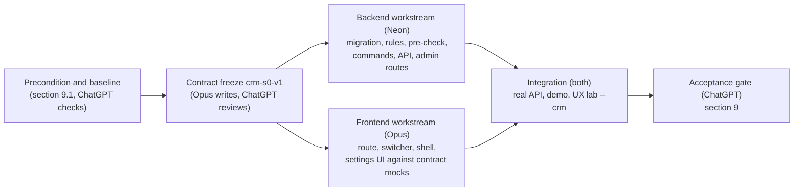

# S0 plan: rails and access

Slice S0 from `11-ROADMAP.md`. A plan for approval: nothing here has been implemented, and implementation has not been authorised. Baseline: `38c388ac1787b0ff14e8e26d7abd1bf8c6bd0444` on branch `crm/foundation` (`00-README.md`). Owner decisions applied: A-19 to A-26 (`01-DECISIONS.md`). No commit, push, remote migration, permission activation, provider or infrastructure change is part of this plan; each needs separate authorisation.

## 1. Outcome

When S0 is done:

1. With `CRM_ENABLED` off (the default), Workspace behaves and renders exactly as at the baseline: the same tests pass under the A-24 rule (section 9.4), the Studio check passes, and UX lab screenshots are pixel-identical.
2. With `CRM_ENABLED` on, the owner sees an app switcher and an empty CRM shell at `/crm` (Home empty state, Settings). Accounts without `crm.access` see no switcher, and `/crm` shows the access-denied state.
3. The owner, and admins the owner authorises, grant and revoke CRM capabilities in **Settings → Accounts and capabilities**; every change is audited append-only (A-21).
4. Disabling an account revokes its CRM capabilities with audit records; re-enabling restores none (A-25).
5. Ordinary admins cannot demote, disable or remove the owner; this is enforced on the server (A-23).
6. A command framework exists with idempotency, revision and authority fences, a journal and both commit modes, exercised by real commands (`capability.grant`, `capability.revoke`) and by test-only commands.
7. `_crm_` projection keys are rejected for every non-command write, in both permission modes.

Not in S0: People grid, endpoints, pack upgrade, MCP tools, `crm_intents`, any provider, any CRM table beyond the three in section 6.2.

## 2. Responsibilities and governance (A-26)

| Party | Owns in S0 | Does not |
|---|---|---|
| **Opus** | Product architecture, UI/UX design, technical contracts (section 3), all frontend files (section 5), frontend tests, the "Commons" demo, UX lab additions, this plan and the `docs/crm/` specification | Write or change backend files (section 6); change an approved decision |
| **Neon** | Backend implementation: migration 0045, `worker/` changes, server-side authorisation (capability rules, projection pre-check, owner protection, disable revocation), the CRM API and command infrastructure, backend tests, certification-script updates (section 6) | Change a shared contract file or its behaviour; change frontend files; change the architecture (ADRs) |
| **ChatGPT** | Central project management and independent review: approves the contract freeze, reviews each workstream against this plan and the contracts, runs or checks the acceptance gates (section 9), tracks SI-01 and the remainder list | Implement; approve a change to an owner decision (that is Paul's) |
| **Paul** | Owner decisions (A-*), authorisation to implement, to commit and push, and every later gate in `11` section 4 | — |

**Rule.** Neither implementation agent may independently redefine the approved architecture or a shared contract. "Shared contract" means everything in section 3. "Approved architecture" means the ADRs in `05`, the decisions in `01` and the data split in `06`.

**Change procedure** (for a contract or architecture change discovered during implementation):

1. The agent that needs the change stops work on the affected part and writes a change request: what, why, evidence (file and line, failing test), and the impact on the other workstream.
2. ChatGPT reviews it against the specification and the `AGENTS.md` invariants.
3. If accepted, Opus updates the contract in `docs/crm/` and the contract file. Neither agent edits the other's files to "make it fit".
4. A change that alters an owner decision, security behaviour, the authority model or a migration already run anywhere also needs Paul's approval, recorded in `01-DECISIONS.md`.
5. Both agents re-run their contract tests (section 8.1) against the new version before continuing.

Implementation choices inside one workstream that leave the contract and architecture unchanged (internal helper names, file-internal structure) need no change request.

## 3. Shared contracts (owned by Opus, frozen before implementation)

**The normative text is `contracts/crm-s0-v1.md`** (candidate, pending ChatGPT review). The table below is an index; where it and the contract document differ, the contract document wins and the difference is a defect in this plan. Both workstreams build against the frozen version.

| ID | Contract | Also described in | Code artefact (author) |
|---|---|---|---|
| SC-1 | Command envelope, error codes, retryability, `requestId` rule (8-64 characters, `[A-Za-z0-9_-]`) | `07` sections 1-2 | `shared/crm/contracts.ts` (Opus): TypeScript types plus zod schemas for request and response bodies |
| SC-2 | Capability catalogue, scopes, labels and descriptions; evaluation rules 1-6 as behaviour | `07` section 3 | `shared/crm/capabilities.ts` (Opus): catalogue constant, `CrmCapability` type, labels. No authorisation logic: the rules are implemented server-side by Neon (SC-2 is the behaviour they must meet) |
| SC-3 | Projection key rule: prefix `_crm_`, only on `tasks` records, only via a registered command's static key list, rejected item-wise as `protected_field` otherwise, in both permission modes | ADR-04, section 6.3 | `shared/crm/projection.ts` (Opus): `CRM_PROJECTION_PREFIX`, `isCrmProjectionKey`, `ProjectionGrant` type |
| SC-4 | CRM HTTP API: `GET /api/crm/status`, `POST /api/crm/commands/:name`, `GET /api/crm/read/capabilities`, `GET /api/crm/read/capability-audit?cursor=`; status codes; 404 for every route except `/status` when `CRM_ENABLED` is off; 401 unauthenticated | contract SC-4 | zod schemas in `shared/crm/contracts.ts` (Opus) |
| SC-5 | `capability.grant` / `capability.revoke` inputs, outputs, errors (`forbidden`, `not_found`, `invalid_input` reasons `guest_not_eligible`, `self_grant`, `owner_implicit`, `unknown_capability`, `unknown_scope`, `account_disabled`, `not_admin`; `stale`); scope `*` only in S0 | `07` section 3 | Types in `shared/crm/contracts.ts` (Opus) |
| SC-6 | Owner protection: `403 { error: 'owner_protected' }` from the three account routes; existing responses otherwise unchanged | `07` section 3 (owner protection table) | Error string constant in `shared/crm/contracts.ts` (Opus) |
| SC-7 | Disable revocation: grants deleted and one audit row per grant (`action: 'revoke'`, `reason: 'account_disabled'`) in the disable batch; enable writes nothing to CRM tables | `07` section 3, rule 6 | Behaviour only |
| SC-8 | Table and column contract for `crm_commands`, `crm_capability_grants`, `crm_capability_audit` | section 6.2 | Migration SQL (Neon) must match it |
| SC-9 | `CRM_ENABLED` semantics: on iff the trimmed, lower-cased value is `1` or `true` (same parsing as `WEBSITE_INGEST_ENABLED`); anything else, or absent, is off | this section | `Env` field (Neon); client reads only `/status` |

### 3.1 CRM HTTP API (SC-4)

Routes, status codes, response types and bounds are defined in `contracts/crm-s0-v1.md`, SC-4: `GET /api/crm/status`, `POST /api/crm/commands/:name` (200 for every business outcome, 401, 404 when disabled or unknown, 413 over 65,536 bytes, 400 invalid body), `GET /api/crm/read/capabilities` and `GET /api/crm/read/capability-audit` (owner or admin with `crm.capabilities.manage`; 50 items per page, keyset cursor).

The CRM Settings Accounts tab also calls the existing Workspace account routes (`07` section 3, "Accounts"). Their contract is the current Workspace behaviour plus SC-6.

## 4. Cross-cutting files, dependencies and integration boundaries

### 4.1 Cross-cutting files (one owner each)

| File | Owner | Why it is cross-cutting | Rule for the other agent |
|---|---|---|---|
| `shared/crm/contracts.ts`, `shared/crm/capabilities.ts`, `shared/crm/projection.ts` | Opus | Imported by frontend and backend | Neon imports only; change requests per section 2 |
| `src/App.tsx` | Opus | Mounts the CRM route; app-wide boot | Neon does not edit |
| `src/core/shell.tsx` | Opus | Workspace shell; the only Workspace UI change | Neon does not edit |
| `worker/index.ts` | Neon | Mounts `/api/crm` | Opus does not edit |
| `worker/sync.ts`, `worker/mutationAccess.ts` | Neon | Every Workspace write goes through them | Opus does not edit; ChatGPT reviews the diff against section 6.3 line by line |
| `worker/admin.ts` | Neon | Workspace account management used by the CRM Accounts tab | Opus does not edit |
| `worker/auth.ts` (`Env` only) | Neon | Env type used by all Worker code | — |
| `package.json` | Opus (scripts only) | Shared manifest | Neon requests script changes; no dependency changes by either without a change request |
| `scripts/qa-ux.mjs`, `scripts/ux-lab/*` | Opus | Workspace screenshot gate | — |
| `scripts/certification/migrations.json`, `scripts/certification/test-files.mjs`, `scripts/access/selftest.mjs` | Neon | Certification of every migration and D1 test | — |
| `scripts/crm-demo/*` | Opus | Uses Neon's API to seed the demo through public routes only | Never writes D1 directly |

### 4.2 Dependencies and order



- Backend and frontend run in parallel after the freeze. The frontend builds against zod-validated mocks generated from SC-4; the backend tests validate its real responses against the same schemas. Neither waits for the other until integration.
- The backend's projection pre-check and owner protection (Workspace-affecting) are reviewed by ChatGPT before integration, independently of the CRM UI.

### 4.3 Integration boundaries

| Boundary | Contract | Checked by |
|---|---|---|
| Browser ⇄ `/api/crm/*` | SC-1, SC-4, SC-5 | Backend: `tests/crm-api-d1.test.ts` validates every response with the shared zod schemas. Frontend: `tests/crm-client-contract.test.ts` validates the mocks with the same schemas |
| Browser ⇄ existing account routes | Current behaviour + SC-6 | Backend: `tests/admin-owner-protection-d1.test.ts`. Frontend: UX lab spec maps `owner_protected` to its message |
| CRM command handler ⇄ `applyChanges` | SC-3, section 6.3 | Backend: `tests/crm-projection-keys-d1.test.ts`, `tests/crm-commands-d1.test.ts` |
| Workspace UI ⇄ switcher | Logo markup unchanged unless `enabled && access` | Frontend: UX lab pixel comparison with CRM off |
| Demo ⇄ API | Public routes only | `npm run demo:crm -- --check` |

## 5. Frontend workstream (Opus)

### 5.1 Files

| Action | File | Purpose |
|---|---|---|
| Add | `shared/crm/contracts.ts`, `shared/crm/capabilities.ts`, `shared/crm/projection.ts` | Section 3 (written first, frozen) |
| Add | `src/routes.tsx` | The route array moved out of `App.tsx` unchanged, plus the CRM route (section 5.2), so routes can be tested without a browser router |
| Change | `src/App.tsx` | `createBrowserRouter(routes)` from `src/routes.tsx`; nothing else |
| Change | `src/core/shell.tsx` | In `SidebarContent` (`:480-488`), replace the static logo block with `<AppSwitcher fallback={<existing logo markup/>}/>`. No other change |
| Add | `src/core/crmStatus.ts` | Store for `GET /api/crm/status`, keyed by account and session token, cleared on account switch and logout; `/api/*` is already never cached by the service worker |
| Add | `src/core/AppSwitcher.tsx` | Menu button (Workspace, CRM), `aria-haspopup="menu"`, Escape returns focus; renders the unchanged logo markup unless `enabled && access`. Imports nothing from `src/apps/crm` |
| Add | `src/apps/crm/CrmShell.tsx` | Lazy-loaded shell, root `<div data-app="crm">`, rail with Home and Settings only in S0; access-denied state when `/status` says disabled or no access |
| Add | `src/apps/crm/routes.tsx`, `Home.tsx` | Descendant routes `index`, `settings/access`; Home empty state (`08` section 15) |
| Add | `src/apps/crm/settings/AccessSettings.tsx` | `08` section 13.1: Accounts, Capabilities, History tabs |
| Add | `src/apps/crm/api.ts` | `runCrmCommand(name, input, expected?)`: fresh `requestId` per user action, same `requestId` on network retry, responses parsed with the shared zod schemas |
| Add | `src/apps/crm/crm.css` | Tokens from `08` section 4 under `[data-app="crm"]` and `.dark [data-app="crm"]`; imported only by `CrmShell.tsx` |
| Add | `scripts/crm-demo/data.mjs`, `preview.mjs` | "Commons" skeleton on `startFixture` with `CRM_ENABLED: 'true'`, generated accounts and passwords; `--check` signs in, opens `/crm`, grants and revokes one capability through the API, writes screenshots to `.artifacts/crm-demo/` |
| Change | `scripts/qa-ux.mjs` | `--crm` starts the fixture with `CRM_ENABLED: 'true'` and runs only `crm-*.spec.mjs`; unchanged without it |
| Add | `scripts/ux-lab/crm-shell.spec.mjs` | Section 9.3, item 3 |
| Change | `package.json` | Script `"demo:crm": "node scripts/crm-demo/preview.mjs"` |

### 5.2 `src/App.tsx` / `src/routes.tsx` routing change

Current: one authenticated route object, pathless, element `<RequireAuth><Shell/></RequireAuth>`, children = module routes + AI + settings + spaces + catch-all `*` → `/` (`src/App.tsx:53-70`).

Add `const CrmShell = lazy(() => import('./apps/crm/CrmShell'));` and a second authenticated route object directly after the existing one:

```tsx
  {
    path: 'crm/*',
    element: (
      <RequireAuth>
        <Suspense fallback={<Loading />}>
          <CrmShell />
        </Suspense>
      </RequireAuth>
    ),
  },
```

`RequireAuth` and `Loading` move with the array or are exported from `App.tsx` unchanged. Why this shape: not a child of the existing route (its element is `Shell`, which would wrap the CRM in Workspace chrome); `crm/*` ranks above the pathless route's `*` child (`:68`), so `/crm` is not redirected to `/`; `RequireAuth` (`:30-35`) gives the same login screen and `AccessBarrier`; `AccountSwitchGate`, `LegacyRecoveryGate` (`:90-91`) and the single `startSyncEngine()` (`:73-85`) are already outside the router; the `/s/` and `/f/` early return (`:79`) is unaffected; the lazy import keeps CRM code and `crm.css` out of the Workspace chunk.

### 5.3 Frontend tests

| File | Asserts |
|---|---|
| `tests/crm-contract.test.ts` | Catalogue has the 13 capabilities of `07` section 3 with unique IDs and labels; every `CrmErrorCode` has a retryability; zod schemas accept the documented examples and reject malformed ones |
| `tests/crm-client-contract.test.ts` | Frontend mocks for every SC-4 route parse with the shared schemas; `runCrmCommand` reuses the `requestId` on network retry and generates a new one per action |
| `tests/crm-routes.test.ts` | `matchRoutes(routes, path)`: `/crm`, `/crm/settings/access` hit the CRM route; `/boards`, `/inbox`, `/settings`, `/unknown` hit exactly what they hit at the baseline |
| `tests/crm-isolation.test.ts` | `src/apps/crm/**` imported only by `src/routes.tsx` (lazily); `src/core/AppSwitcher.tsx` imports nothing from `src/apps/crm`; every `crm.css` selector starts with `[data-app="crm"]` or `.dark [data-app="crm"]`; `COLLECTIONS` unchanged |
| `scripts/ux-lab/crm-shell.spec.mjs` | Section 9.3 item 3 |

### 5.4 Frontend acceptance

- All frontend tests pass; `npm run typecheck` and `npm run build` pass.
- UX lab with CRM off: zero differing pixels on every existing surface in all 18 projects.
- UX lab with `--crm`: all assertions in section 9.3 item 3 pass in all 18 projects; axe reports no violations on CRM screens.
- Settings UI never shows optimistic success; `owner_protected`, `forbidden`, `stale` and every `invalid_input` reason have a user-facing message.
- Offline: capability switches disabled with the reason; nothing queued.

## 6. Backend workstream (Neon)

### 6.1 Precondition (read-only)

Locally and, before release, on an owner-exported copy of production: exactly one active account has `COALESCE(workspace_role, role) = 'owner'`, and it is Paul's. Migration 0012 made the earliest-created admin the owner on databases that predate it (`migrations/0012_phase5_access_foundation.sql:37-39`), so on an older ledger the owner may not be Paul's account. If it is not, Paul corrects ownership through a reviewed step before the CRM is enabled; S0 adds no ownership transfer.

### 6.2 Migration `0045_crm_foundation.sql` (SC-8)

Only the tables S0 uses. Later CRM tables arrive with their slices' additive migrations.

```sql
-- CRM S0: command journal and capability grants. Server-only; never in COLLECTIONS.
CREATE TABLE crm_commands (
  id TEXT PRIMARY KEY,
  name TEXT NOT NULL,
  actor_id TEXT NOT NULL,
  via TEXT NOT NULL CHECK (via IN ('ui','mcp','automation','ingest')),
  request_id TEXT NOT NULL CHECK (length(request_id) BETWEEN 8 AND 64),
  request_hash TEXT NOT NULL,
  result TEXT NOT NULL DEFAULT '{}',
  created_at INTEGER NOT NULL,
  UNIQUE (actor_id, request_id)
);
CREATE INDEX crm_commands_actor_time ON crm_commands(actor_id, created_at);

CREATE TABLE crm_capability_grants (
  user_id TEXT NOT NULL REFERENCES users(id) ON DELETE CASCADE,
  capability TEXT NOT NULL CHECK (length(capability) BETWEEN 1 AND 64),
  scope TEXT NOT NULL CHECK (length(scope) BETWEEN 1 AND 64),
  granted_by TEXT NOT NULL,
  granted_at INTEGER NOT NULL,
  reason TEXT,
  PRIMARY KEY (user_id, capability, scope)
);

-- No foreign key: audit rows outlive removed accounts, and an ON DELETE action
-- on an append-only table would make DELETE /api/users/:id fail.
CREATE TABLE crm_capability_audit (
  id TEXT PRIMARY KEY,
  actor_id TEXT NOT NULL,
  target_user_id TEXT NOT NULL,
  action TEXT NOT NULL CHECK (action IN ('grant','revoke')),
  capability TEXT NOT NULL,
  scope TEXT NOT NULL,
  before_json TEXT NOT NULL DEFAULT '{}',
  after_json TEXT NOT NULL DEFAULT '{}',
  reason TEXT,
  request_id TEXT NOT NULL,
  created_at INTEGER NOT NULL,
  UNIQUE (actor_id, request_id)
);
CREATE INDEX crm_capability_audit_time ON crm_capability_audit(created_at, id);
CREATE TRIGGER crm_capability_audit_no_update BEFORE UPDATE ON crm_capability_audit
BEGIN SELECT RAISE(ABORT, 'crm_capability_audit is append-only'); END;
CREATE TRIGGER crm_capability_audit_no_delete BEFORE DELETE ON crm_capability_audit
BEGIN SELECT RAISE(ABORT, 'crm_capability_audit is append-only'); END;
```

The grants foreign key follows the existing pattern (`migrations/0001_init.sql:14`, `0012_phase5_access_foundation.sql:26`). Size bounds on `result` and `reason` are enforced in request validation. Test helpers must split the file with trigger bodies intact (the existing regex handles `CREATE TRIGGER ... END;`, `tests/phase5-audit-interplay-d1.test.ts:55`). Register the file with its SHA-256 in `scripts/certification/migrations.json` (`scripts/certify-phase4.mjs:181` fails otherwise). Local only: `npm run db:migrate:local`; no remote migration.

### 6.3 Exact changes to existing Worker code

**`worker/sync.ts`**

1. `ApplyOptions` (`:158-194`) gains:

```ts
  /** Set ONLY by worker/crm/commands.ts from a registered command's static key list.
   * Never set by the sync router, MCP generic tools, automations, history or undo. */
  projection?: ProjectionGrant;
  /** Server-only CRM rows committed in the same single batch. Requires atomic: true. */
  commit?: () => D1PreparedStatement[];
```

2. In `applyChanges`, immediately after `incoming=incoming.map(ch=>({...ch,patch:{...ch.patch}}));` (`:350`) and before the permission branch (`:352-353`), an unconditional, item-wise pre-check:

```ts
  if (opts.commit && opts.atomic !== true) throw new Error('commit requires atomic: true');
  const projectionDenied = projectionRejections(incoming, opts.projection);
  if (projectionDenied.length) {
    const ids = new Set(projectionDenied.map(r => r.id));
    for (const r of projectionDenied) reject(r.id, r.collection, 'protected_field');
    incoming = incoming.filter(ch => !ids.has(ch.id));
    if (opts.atomic === true || (!!opts.expect?.size && opts.atomic !== false)) return { rejected, rejectedItems, changed: 0, applied: [] };
  }
```

`projectionRejections` (in `worker/crm/projection.ts`, using SC-3 from `shared/crm/projection.ts`) rejects a change if any patch key is a `_crm_` key and either there is no grant, the key is not in `grant.keys`, or the collection is not `tasks`.

3. Pass the grant into the authorizer at `:355`: `authorizeMutations(db, userId, incoming, existing, opts.expect, opts.session?.tokenHash, env.CONNECTOR, opts.projection)`.

4. In `flushPlans` (`:526`): append `...(opts.commit?.() ?? [])` once per chunk, after the record statements and checkpoints and before `db.batch` (`:614`); `atomic: true` already makes the write one chunk (`:560`). If `opts.commit` is set and no plan changed (`todo` empty at `:556`), run exactly one batch of `[...writeAuthorityFences (if authority), opts.execution?.guard(), ...fences, ...commit()]`. Existing callers pass neither option, so their behaviour is unchanged.

**`worker/mutationAccess.ts`**

1. Signature (`:48`): add a trailing optional parameter `projection?: ProjectionGrant` after `connector`.
2. The protected-field loop (`:65-68`) becomes:

```ts
    for (const field of Object.keys(ch.patch)) {
      const projected = !!projection && isCrmProjectionKey(field) && projection.keys.has(field);
      if ((field.startsWith('_') && !projected) || ['space_id', 'collection', 'uploadClaimHash', 'uploadClaim', 'uploadSubmission'].includes(field)
          || (field === 'id' && ch.patch.id !== ch.id)) reject(ch.id, ch.collection, 'protected_field');
    }
```

A projected key still counts as a touched field, so the existing space edit checks and capability-level fences apply when permissions are on.

**`worker/admin.ts`: owner protection (A-23, SC-6).** These three routes are the only server paths that change another account's role or status; every other `UPDATE users` is a self-edit (`worker/auth.ts:466-489`, `worker/email.ts:156`, `worker/notificationEmail.ts:222-224`).

1. In `PATCH /users/:id` (`:165-179`), `POST /users/:id/disable` (`:108-124`) and `DELETE /users/:id` (`:206-215`): after reading `before`, return `403 { error: 'owner_protected' }` when `before.canonicalRole === 'owner'` and `target !== actor.id`. The owner acting on itself stays refused by the existing self-checks (`:109`, `:169`, `:208`).
2. Race backstop in the same batch: extend `accountFence` (`:103-105`) with an optional `protectOwner` flag that adds `AND COALESCE(workspace_role,role) != 'owner'` for these three routes, so a target that became owner between read and commit aborts the batch (existing `account_or_authority_changed` 409).
3. Keep the existing last-privileged-account fence (`protectLast`, `:103-105`) unchanged.
4. Net effect, to be asserted by tests: no HTTP route can take the owner out of the `owner` role, disable it or remove it, so the workspace cannot lose its last owner through account management.

**`worker/admin.ts`: revocation on disable (A-25, SC-7).** In `POST /users/:id/disable`, inside the existing batch (`:111-118`), when `already` is false, before the `UPDATE users SET disabled_at`:

```sql
INSERT INTO crm_capability_audit(id,actor_id,target_user_id,action,capability,scope,before_json,after_json,reason,request_id,created_at)
  SELECT lower(hex(randomblob(16))), ?1, user_id, 'revoke', capability, scope,
         json_object('held',1,'grantedBy',granted_by,'grantedAt',granted_at), json_object('held',0),
         'account_disabled', ?2 || ':' || capability || ':' || scope, ?3
  FROM crm_capability_grants WHERE user_id = ?4;
DELETE FROM crm_capability_grants WHERE user_id = ?4;
```

`?1` actor, `?2` `'disable:' || <a fresh UUID for this request>` (so a later second disable of the same account cannot collide with `UNIQUE(actor_id, request_id)` and abort the disable), `?3` now, `?4` target. `POST /users/:id/enable` writes nothing to CRM tables. Both statements are inside the one existing batch, so the binding-call count of the route does not change.

### 6.4 Backend files

| Action | File | Purpose |
|---|---|---|
| Add | `migrations/0045_crm_foundation.sql` | Section 6.2 |
| Add | `worker/crm/rules.ts` | Pure capability evaluation and grant-management rules implementing SC-2 and SC-5 (`holdsCapability`, `canManageGrant`) |
| Add | `worker/crm/projection.ts` | Pure `projectionRejections` implementing SC-3 |
| Add | `worker/crm/commands.ts` | `defineCommand`, `createCommandRegistry(defs)` (a function, called per request; no module-level mutable state), `runCommand` (section 6.5) |
| Add | `worker/crm/grants.ts` | `actorFence`, `capabilityFence`, `effectiveCapabilities`, `capability.grant` and `capability.revoke` definitions, audit reads |
| Add | `worker/crm/index.ts` | `crmApi` Hono router for SC-4 |
| Change | `worker/sync.ts`, `worker/mutationAccess.ts`, `worker/admin.ts` | Section 6.3 |
| Change | `worker/index.ts` | `app.route('/api/crm', crmApi);` before `app.route('/api', admin);` (`:123`), so `/api/crm/*` never reaches the admin sub-app's middleware or the `/api/*` 404 (`:125`) |
| Change | `worker/auth.ts` | `Env` (`:10`) gains `CRM_ENABLED?: string` (SC-9) |
| Change | `wrangler.jsonc` | No change (absent means off). Fixtures pass the var through `startFixture({ vars })` (`scripts/phase4-fixture.mjs:76,78`). If `wrangler.jsonc` ever changes, run `npm run cf-typegen` |
| Change | `scripts/certification/migrations.json` | Register 0045 |
| Change | `scripts/access/selftest.mjs` | `:33` hard-codes `0044_history_body_context.sql` as the last migration; read the last file in `migrations/` instead |
| Change | `scripts/certification/test-files.mjs` | Add `crm` to the D1 selection pattern (`:3`) |

Unchanged by design: `shared/collections.ts`, `src/core/db.ts`, `src/sw.ts`, `src/index.css`, every Workspace module, `templates/*.json`, `docs/integrations/the-common-ground.md`.

### 6.5 Command framework shape

```ts
// worker/crm/commands.ts
interface CommandDef<I, O> {
  name: string;                                   // 'capability.grant'
  parse(input: unknown): I | { invalid: Record<string, string> };
  /** Capability required of the actor; null for commands with their own rule (grant/revoke). */
  capability: ((input: I) => { capability: CrmCapability; scope: string }) | null;
  /** Static list; the only _crm_ keys this command may write. Empty for server-only commands. */
  projectionKeys: readonly string[];
  /** One bounded read (at most 2 binding calls) of the state the plan depends on. */
  load(env: Env, actor: Actor, input: I): Promise<Loaded>;
  /** Pure: decide and return statements; no I/O. */
  plan(input: I, loaded: Loaded, ctx: { actor: Actor; now: number; id: () => string }):
    | { error: CrmErrorCode; detail?: Record<string, unknown> }
    | { result: O; fences: D1PreparedStatement[]; rows: D1PreparedStatement[]; records?: Mutation[]; expect?: Map<string, number> };
}
```

`runCommand` per request:

1. Wrap env with `withD1Budget(env, 45)` and the request's read gate (`withReadGate`).
2. Validate `requestId`; hash `{name, input}` with the existing SHA-256 helper.
3. Look up `crm_commands` by (actor, requestId): same hash → stored result; different hash → `idempotency_conflict`.
4. `load`, then `plan`. A plan error returns without writing and without a journal row.
5. Statements always include the actor fence (session live, account active, same token hash, as `adminSessionFence` at `worker/admin.ts:19-24`), the capability fence when `capability` is set, the command's own fences, and the journal insert (its UNIQUE constraint is the idempotency race backstop).
6. Commit: server-only mode `db.batch([...])` when `records` is empty; records mode `applyChanges(env, actor.id, records, { serverTs: true, atomic: true, expect, session: { tokenHash }, projection: { command: name, keys: new Set(projectionKeys) }, fences, commit: () => [...rows, journal] })`.
7. A fence abort (`malformed JSON`, the repository's fence signal) returns `stale`, `retryable: true`; a UNIQUE violation on the journal means a concurrent identical request: re-read and return the stored result.
8. No `journal` (changesets) option, so generic Undo never applies to commands.

`capability.grant` example: one load batch (actor row, target row, existing grant); refuse per SC-5; on change `rows = [INSERT grant, INSERT audit]`, `fences = [target account fence (role and disabled state as read), manage-rights fence for a non-owner actor]`. Three binding calls in total.

### 6.6 Backend tests (written first)

| File | Asserts |
|---|---|
| `tests/crm-projection-keys-d1.test.ts` | With `access_state.enabled = 0` and `= 1`: a client push (`applyChanges` without options) containing `_crm_x` is rejected item-wise with `protected_field` and the row is unchanged; without the key it applies; a grant listing `_crm_x` on a `tasks` record succeeds; it does not allow `_crm_y`; a grant on a `pages` record is rejected; other `_` keys keep their current behaviour in disabled mode. In disabled mode this test fails before the change, which proves V-01 |
| `tests/crm-mcp-projection-d1.test.ts` | `update_records` with a `_crm_` key is refused for a connector request; `query_records` still returns the record |
| `tests/crm-rules.test.ts` | SC-2 rules 1-6 and SC-5 refusals as pure cases: owner holds everything; member with no rows holds none; scoped versus `*`; guest never; manage ignored for a non-admin; no self-grant; owner-target; only the owner grants manage |
| `tests/crm-commands-d1.test.ts` | Test-only registry built in the test: idempotent replay with one journal row; `idempotency_conflict`; `stale` on revision mismatch, nothing written; disabled actor or deleted session between load and commit → `stale`, nothing written; both commit modes commit rows, projection and journal together; unchanged projection still commits rows; every request inside `withD1Budget(env, 45)` |
| `tests/crm-grants-d1.test.ts` | Grant and revoke by the owner; one audit row per change, none for `already`; admin without manage → `forbidden`; admin with manage cannot self-grant or grant manage; demotion removes manage effect; guest → `guest_not_eligible`; owner → `owner_implicit`; disabled target → `account_disabled`; manage to a member → `not_admin`; scope other than `*` → `unknown_scope`; audit UPDATE and DELETE raise; removing an account deletes grants and keeps audit rows; permissions off and on |
| `tests/crm-disable-revocation-d1.test.ts` | Disabling an account with grants deletes them all and writes exactly one `revoke`/`account_disabled` audit row per grant, in the same batch as `disabled_at`; a failed disable (fence abort) leaves grants and audit untouched; re-enabling leaves the account with zero grants and writes no CRM rows; disable, enable, grant, disable again succeeds (no request-ID collision); an already-disabled account writes nothing |
| `tests/admin-owner-protection-d1.test.ts` | Called through the HTTP routes with an admin session, not through UI: an admin's `PATCH` role, `disable` and `DELETE` on the owner each return 403 `owner_protected` and change nothing; the owner can still change, disable and remove admins and members; the owner's own self-changes remain refused; the last-privileged fence still blocks removing the last admin-level account; the race backstop aborts a batch whose target became owner after the read |
| `tests/crm-api-d1.test.ts` | Every SC-4 response validated with the shared zod schemas; 404 for all but `/status` when `CRM_ENABLED` is unset or not `true`; `/status` `access: false` for a member without grants; 401 unauthenticated; capability reads 403 for a member |

### 6.7 Backend acceptance

- All backend tests pass, in both permission modes where stated.
- ChatGPT has reviewed the `worker/sync.ts`, `worker/mutationAccess.ts` and `worker/admin.ts` diffs against section 6.3 and confirmed no other Workspace behaviour changed.
- Migration 0045 applies on fresh local D1 and is registered; the certification migration check passes.
- No new synced collection, no remote migration, no provider call.

## 7. Integration (both, coordinated by ChatGPT)

1. Point the frontend at the real API in the local fixture; remove mocks from the running build (mocks stay in tests).
2. `npm run demo:crm -- --check` passes.
3. `npm run qa:ux -- --crm` passes.
4. A keyboard-only walkthrough by a reviewer of switcher → CRM → grant → revoke → History, at desktop and at the compact layout.

## 8. Contract tests shared by both workstreams

8.1 Both `tests/crm-contract.test.ts` (Opus) and `tests/crm-api-d1.test.ts` (Neon) import the same zod schemas. A contract change bumps `crm-s0-v1`, and both must pass again before integration continues.

## 9. Workspace regression gate and acceptance

### 9.1 Before any code change (baseline)

1. The baseline in `00-README.md` (24 November 2026, `38c388a`): `npm test` 2,227 passed and 3 failed of 2,230 tests in 218 files; typecheck, build and the Studio check passed.
2. `npx playwright install chromium firefox webkit` if browsers are missing, then `npm run qa:ux -- --record` to capture screenshot baselines into `.artifacts/ux-lab/baselines/` (git-ignored). Keep the run directory as "before" evidence. Not yet done.

### 9.2 Coverage of compact, tablet and desktop in light and dark

- `scripts/screenshots.mjs`: **does not cover them.** Chromium only; 1440×900 light plus two dark shots, 390×844 light only; no tablet; no comparison (PNG files to `/tmp/notion-shots`); it creates data and needs the `admin` user from `npm run smoke`. Not used as the gate and not extended.
- `npm run qa:ux`: **covers them.** 18 projects (Chromium, Firefox, WebKit × 390×844, 820×1180, 1440×900 × light, dark), fresh fixture, `toHaveScreenshot` with `maxDiffPixels: 0` (`scripts/ux-lab/playwright.config.mjs`), surface catalogue in `scripts/ux-lab/catalog.mjs`. Added for S0: `--crm` and `crm-shell.spec.mjs` only.

### 9.3 After S0

1. `npm test`, `npm run typecheck`, `npm run build`, `npm run demo:studio -- --check`, judged by the rule in 9.4.
2. `npm run qa:ux` with CRM off: zero differing pixels on every existing surface in all 18 projects.
3. `npm run qa:ux -- --crm`: CRM baselines (Workspace home with switcher, CRM Home, Settings Accounts, Capabilities, History, access denied) in all 18 projects; axe on each CRM screen; keyboard-only path (switcher → CRM → capability switch → Space → live-region announcement); and, per `docs/architecture/cross-platform-responsive-web.md`: no root horizontal overflow at 320×568, 200% text keeps actions reachable, targets at least 24×24 CSS pixels and 44×44 on touch layouts, focus visible and returned after the menu and phone sheet close, status in text as well as colour.
4. `npm run demo:crm -- --check`.
5. Report exact commands and counts. Playwright WebKit is not iOS Safari. Real-device rows and native 400% zoom are NOT RUN unless devices are provided.

### 9.4 Test acceptance rule (A-24)

Tolerated failures: **only** the three SI-01 tests, each with its baseline signature.

| Test (file › full name) | Baseline failure signature |
|---|---|
| `tests/phase4-events-d1.test.ts` › Phase 4 real D1 deadline indexing and reminder recovery › Cron recovers durable events after interruption and a failed sweep, then dedupes subsequent sweeps | `beforeEach` hook timeout (30,000 ms) at the Miniflare setup hook |
| `tests/phase8-commitments-d1.test.ts` › keeps private action metadata out while retaining available decisions | `read ECONNRESET` |
| `tests/phase8-form-operations-d1.test.ts` › fences disablement and session revocation during a read | Test timeout (30,000 ms) |

A full-suite run is accepted only if all of the following hold:

1. Every failing test is one of the three above, and its failure matches its signature (same error kind: hook timeout, connection reset, test timeout). An assertion failure, a different exception or a failure at a different hook counts as **changed failure behaviour** and blocks.
2. Each tolerated failing file, re-run alone with `npx vitest run <file>`, exits 0 with all its tests passing.
3. Every test that passed at the baseline still passes, and every new S0 test passes.
4. The total test count is at least the baseline 2,230 plus the S0 tests added; the three SI-01 tests are still present and not marked `skip`, `todo` or `only`, and their timeouts are unchanged (checked by grep in the review).
5. Any other failure, in any file, blocks acceptance, including a failure that passes on rerun.

SI-01 stays open (`12`) and must be investigated and stabilised **before production release** (`11` section 5).

### 9.5 Review checkpoints (ChatGPT)

| Checkpoint | Evidence required |
|---|---|
| Contract freeze `crm-s0-v1` | Section 3 artefacts, `tests/crm-contract.test.ts` green |
| Backend review | Section 6.7 items, the three Workspace-file diffs reviewed |
| Frontend review | Section 5.4 items |
| S0 acceptance | Section 9.3 results under the 9.4 rule, exact commands and counts, NOT RUN list |
| Commit and push | Only after Paul authorises it separately |

## 10. Rollback

| Situation | Action |
|---|---|
| Before release | Revert the S0 changes. Migration 0045 has not run anywhere remote. |
| Released, problem in the CRM shell or settings | Unset `CRM_ENABLED` and redeploy the same code: the switcher reverts to the logo, `/crm` shows access denied, `/api/crm/*` returns 404. Grants and audit stay. |
| Released, problem in the projection pre-check | It rejects only `_crm_` keys, which no Workspace code writes; revert the `worker/sync.ts` and `worker/mutationAccess.ts` hunks only if a non-CRM write path is shown to be affected, and re-run the projection tests. |
| Migration 0045 must be undone before any grant exists | Drop both triggers, then the three tables; remove the entry from `scripts/certification/migrations.json`. After grants exist, do not drop: disable the CRM and keep the tables, because they are authority and audit records. |
| Owner protection or disable revocation causes an account-management problem | Revert the corresponding `worker/admin.ts` hunk. It is independent of the rest of S0, but reverting owner protection reopens C-06 and needs Paul's approval. |
