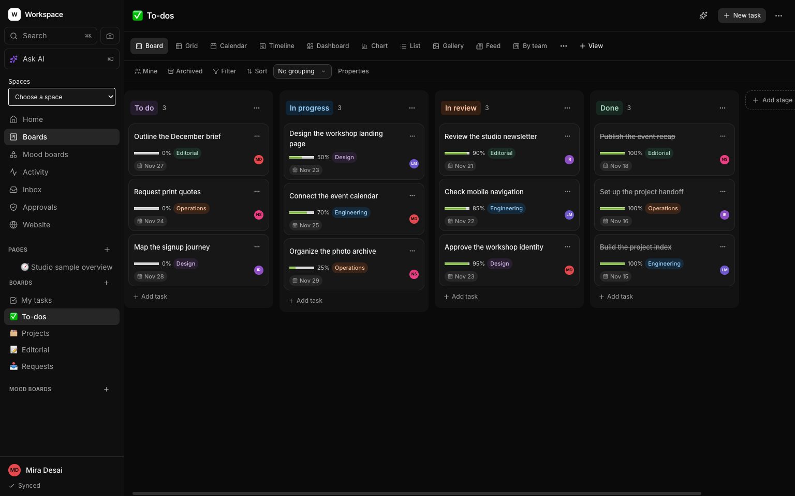
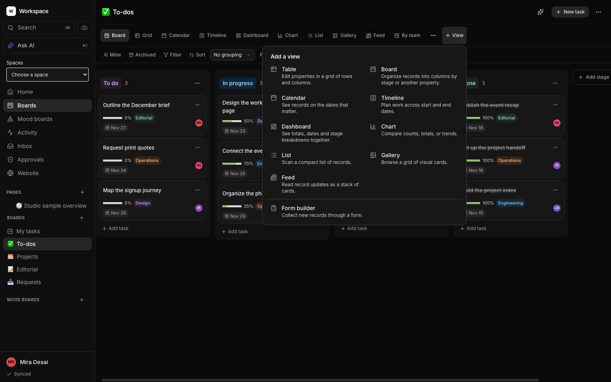

# Studio demo and project handoff

Studio is a fictional Workspace with 36 records, 19 saved views, and four sample teammates. It shows how one codebase can support projects with different stages, properties, dashboards, and intake forms.

| Database | Records | What to explore |
| --- | ---: | --- |
| To-dos | 12 | Move cards between colored stages. Switch among Board, Grid, Calendar, Timeline, Dashboard, Chart, List, Gallery, Feed, and the By team board. |
| Projects | 8 | Switch between the portfolio board, roadmap, and portfolio dashboard. |
| Editorial | 8 | Review the pipeline, publishing calendar, and story feed. |
| Requests | 8 | Review the triage board, grid, chart, and draft intake form. |

Studio sample overview combines live counts and recent updates from the databases. **+ View** opens the picker. **Table** in the picker is the type used by the saved **Grid** tab. **Form builder** opens the selected database's form manager.





## Run locally

Use Node 24.5 or later, npm, and OpenSSL. Install the project dependencies and the browser engines used by the demo.

```sh
npm ci
npx playwright install chromium webkit
npm run demo:studio
```

The command builds Workspace, starts an isolated loopback HTTPS fixture with a fresh local database, and seeds the example. A signed-in Chromium window opens on To-dos. Leave the command running while exploring. Closing the browser or stopping the command ends the preview. Certificate trust is scoped to the demo processes. The fixture uses generated local credentials and a draft form with responses disabled.

For a headless run, use `npm run demo:studio -- --check`. It verifies the boards, the To-dos views, a card move and sync, the overview and form, and the compact picker. It records screenshots and results under the ignored `.artifacts/studio-demo/` directory. These checks cover a local browser fixture.

## Continue from GitHub

Use `YHWH3/tcg-workspace` at branch `codex/workspace-database-platform`. Read [the configurable-database roadmap](../14-configurable-databases.md) for what shipped locally and the remaining scope. The [sample schema and records](../../../scripts/studio-demo/data.mjs) and [fixture runner](../../../scripts/studio-demo/preview.mjs) show how the demo was assembled.

For another project, start with the project brief and pick the boards, fields, workflows, views, and forms it needs. Build those as project-specific configuration in a separate local fixture first. Verify one workflow in the browser and through MCP against the same data. For example, read a database's saved views with `list_database_views`, then use its view ID with `query_records`. The demo also uses `add_view`, `set_default_view`, `append_dashboard_widgets`, and `save_form_draft` through local OAuth and MCP. Keep launch and provider configuration separate from the sample setup.
